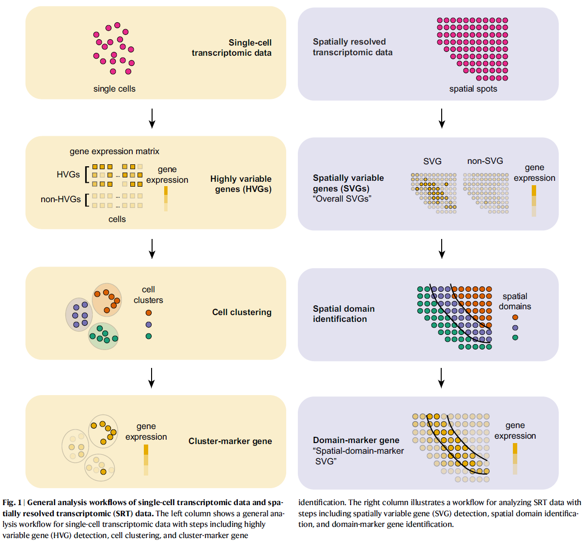
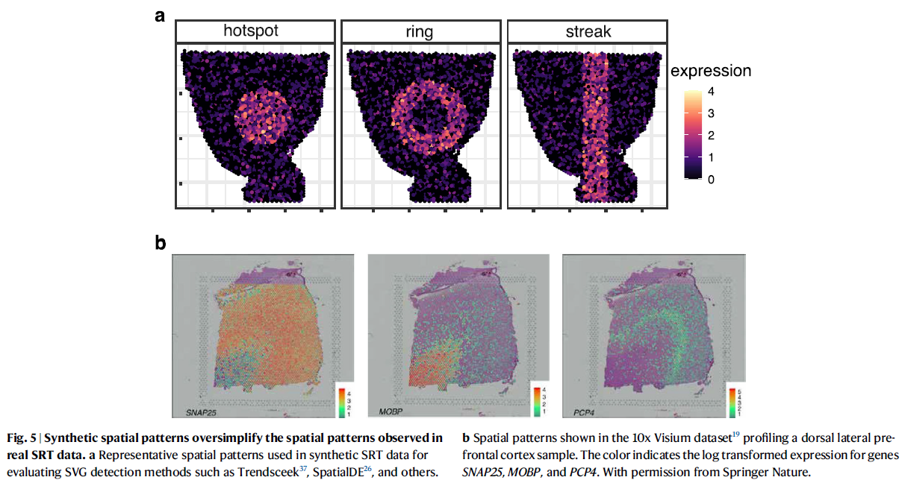
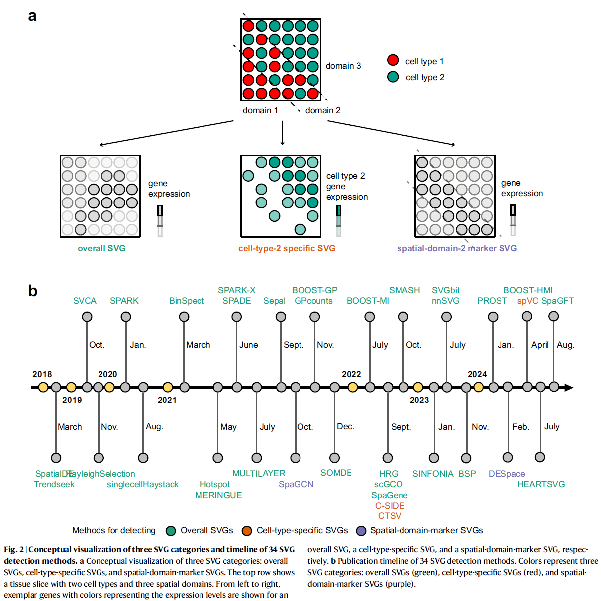
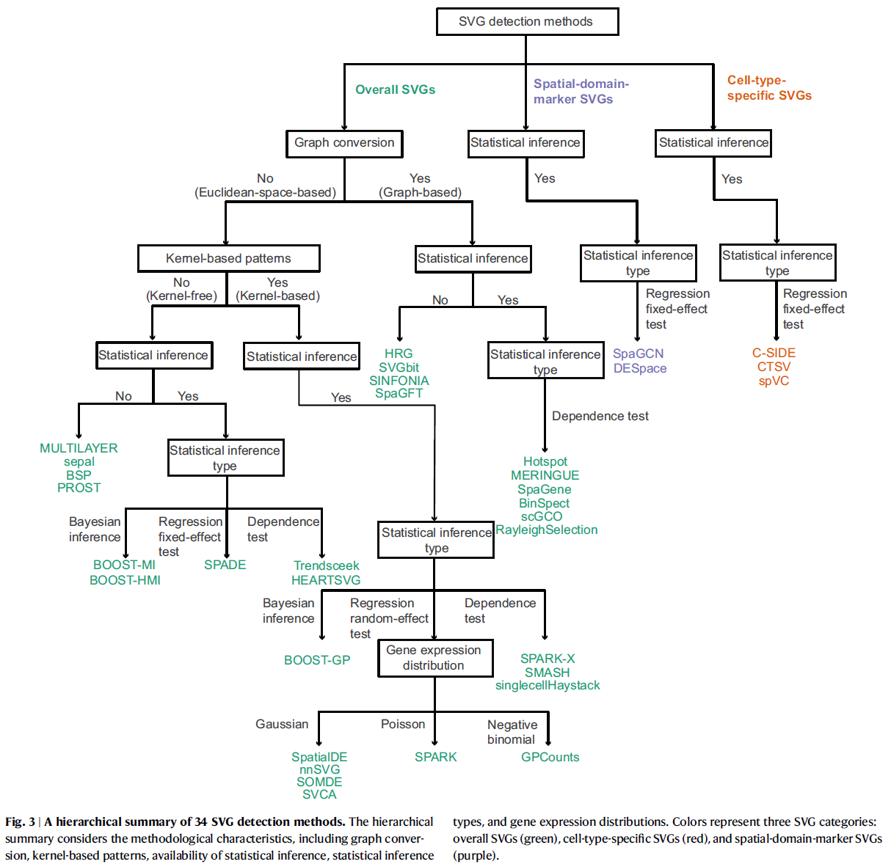

# Quem sou eu

-   Biomédico pela UFPR
-   Especialização em Data Science & Big Data pela UFPR, concluída
-   Especialização em Inteligência Artificial Generativa pela UFPR, em andamento
-   Mestrando em Bioinformática, PPGBioinfo, UFPR
-   Projeto: métodos estatísticos e computacionais para detectar **genes espacialmente variáveis**
-   Ou seja: o tema de hoje é o meu dia a dia de pesquisa

## Roteiro da aula

1.  Transcriptômica espacial: Visium e o dataset `stxBrain`
2.  Controle de qualidade e filtragem
3.  Normalização e redução de dimensionalidade
4.  Clusterização e visualização no Seurat
5.  Expressão diferencial: SVG vs. DEG
6.  Genes Espacialmente Variáveis: teoria e Moran's I
7.  Visualização: RGraphSpace + PathwaySpace

# Abertura

## O que muda com a espacialidade

-   Single-cell RNA-seq: expressão gênica **sem localização**
-   Spatial RNA-seq: expressão gênica **preservando a posição no tecido**
-   Plataforma **Visium** (10x Genomics):
    -   lâmina com milhares de *spots* de 55 µm
    -   cada spot captura o transcriptoma daquele pedaço de tecido
-   **Imagem histológica (H&E) como contexto**

## Spot não é célula

-   Single-cell: 1 barcode aprox. 1 célula
-   Visium: 1 spot contém **de 1 a 10 células**
-   Consequências:
    -   QC, clusters e "células" do Seurat são, na prática, **spots**
    -   Clusters se referem a **regiões teciduais**, não a tipos celulares
    -   Métodos de single-cell funcionam, mas a **interpretação muda**

## Do single-cell para o espacial

{width="52%" fig-align="center"}

## Dataset da aula: `stxBrain`

-   Uma seção sagital **anterior** de cérebro de camundongo (10x Genomics)
    -   `anterior1`: 2.696 spots
-   Distribuído no pacote `SeuratData`
-   Todo o pipeline de hoje roda nessa única seção

## O objeto Seurat

-   `assays`: matrizes de expressão (`Spatial`: counts e dados normalizados)
-   `layers`: `counts`, `data`, `scale.data`
-   `images`: coordenadas dos spots + imagem histológica
-   `meta.data`: métricas por spot (`nCount_Spatial`, clusters)
-   `reductions`: PCA, UMAP (criadas no pipeline)

## Carregar os pacotes

```{r carregar-pacotes}
# CRAN
if (!require("Seurat"))        install.packages("Seurat")
if (!require("SeuratData"))    install.packages("SeuratData")
if (!require("ggplot2"))       install.packages("ggplot2")
if (!require("patchwork"))     install.packages("patchwork")
if (!require("dplyr"))         install.packages("dplyr")

# Visualizacao (Sysbiolab)
if (!require("RGraphSpace"))   install.packages("RGraphSpace")
if (!require("PathwaySpace"))  install.packages("PathwaySpace")

library("Seurat")
library("SeuratData")
library("ggplot2")
library("patchwork")
library("dplyr")
library("RGraphSpace")
library("PathwaySpace")
```

## Carregar os dados

```{r carregar-dados}
#| warning: false
if (!require("stxBrain.SeuratData")) {
  SeuratData::InstallData("stxBrain")
}

brain <- SeuratData::LoadData("stxBrain", type = "anterior1")
```

```{r inspecionar-dados}
dim(brain)   # genes x spots
```

# Controle de qualidade

## O que medir por spot

-   `nCount_Spatial`: total de transcritos (UMIs) no spot
-   `nFeature_Spatial`: número de genes detectados no spot
-   Pergunta do QC: **meus spots representam tecido íntegro?**
-   Particularidade do espacial:
    -   QC é consolidado em single-cell, ainda pouco padronizado em espacial
    -   usaremos **critérios simples e transparentes**

## Inspecionar as métricas

```{r qc-inspecionar}
#| fig-asp: 0.85
#| out-width: 100%
plot1 <- VlnPlot(brain, features = "nCount_Spatial", pt.size = 0.1) + NoLegend()
plot2 <- SpatialFeaturePlot(brain, features = "nCount_Spatial") +
  theme(legend.position = "right")

plot3 <- VlnPlot(brain, features = "nFeature_Spatial", pt.size = 0.1) + NoLegend()
plot4 <- SpatialFeaturePlot(brain, features = "nFeature_Spatial") +
  theme(legend.position = "right")

wrap_plots(plot1, plot2, plot3, plot4, ncol = 2)
```

## Decidir o limiar com um histograma

```{r qc-histograma}
#| fig-asp: 0.45
#| out-width: 100%
hist(
  brain$nCount_Spatial,
  breaks = 60,
  col  = "grey90",
  main = "",
  xlab = "Contagens por spot (nCount_Spatial)"
)
```

-   Onde começa a cauda de spots com pouquíssimas contagens?
-   Decisão **olhando os dados**, sem número mágico

## Filtragem: dois critérios simples

```{r qc-filtrar}
#| warning: false
# 1) Genes detectados em pelo menos 1% dos spots
n_spots  <- ncol(brain)
genes_ok <- rowSums(GetAssayData(brain, layer = "counts") > 0) >= 0.01 * n_spots

brain <- brain[genes_ok, ]

# 2) Spots acima do limiar decidido no histograma
limiar_counts <- 100
brain <- subset(brain, subset = nCount_Spatial > limiar_counts)
```

```{r qc-antes-depois}
dim(brain)                        # depois dos filtros
quantile(brain$nCount_Spatial)    # distribuicao de contagens que seguem
```

# Normalização

## Por que normalizar

-   Profundidade de sequenciamento varia entre spots:
    -   causas técnicas: captura, eficiência
    -   causas biológicas: densidade celular, tecido
-   Objetivo: **tornar spots comparáveis** sem apagar o sinal biológico

## LogNormalize vs. SCTransform

|   | LogNormalize | SCTransform |
|------------------------|------------------------|------------------------|
| O que faz | counts / total x 10.000, depois log1p | modelo por gene, Pearson residuals |
| Complexidade | baixa, transparente | alta, mais lenta |
| Indicado para | didático, inspeção | produção, grandes conjuntos |

-   Hoje: **LogNormalize**
    -   rápida e de leitura fácil
    -   implementada nativamente no fluxo padrão do Seurat

## Três passos explícitos

```{r normalizar}
# 1) Normalizacao por spot
brain <- NormalizeData(brain)
```

```{r genes-variaveis}
# 2) Selecionar genes variaveis (entrada da PCA)
brain <- FindVariableFeatures(brain)
```

```{r escalar}
# 3) Scaling por gene (z-score), cria a layer scale.data usada pela PCA
brain <- ScaleData(brain)
```

## Conferir genes conhecidos no tecido

```{r genes-conhecidos}
#| fig-asp: 0.45
#| out-width: 100%
SpatialFeaturePlot(brain, features = c("Hpca", "Ttr"))
```

-   `Hpca`: marcador do hipocampo
-   `Ttr`: plexo coroide
-   Checagem anatômica: o dado faz sentido no tecido?

# Redução de dimensionalidade

## PCA

```{r pca}
brain <- RunPCA(brain, assay = "Spatial", verbose = FALSE)
```

-   Resume milhares de genes nas **principais fontes de variação** (PCs ranqueadas)
-   As top PCs alimentam UMAP e clusterização
-   Hoje usamos as **30 primeiras PCs**, um valor que faz sentido para Visium

## UMAP

```{r umap}
brain <- RunUMAP(brain, reduction = "pca", dims = 1:30)
```

-   Método **não linear** para visualizar em 2D
-   t-SNE: alternativa, mesma função (não rodaremos hoje)

# Clusterização

## A ideia

-   Delimitar **regiões teciduais** para análise compartimentada
-   Estratégia padrão (teoria de grafos):
    -   grafo de vizinhança **K-Nearest Neighbors** no espaço das PCs
    -   detecção de comunidades (Louvain) no grafo **Shared Nearest Neighbors**
-   `resolution`: granularidade da busca
    -   baixa, menos clusters; alta, mais clusters

## Na prática

```{r clusterizar}
set.seed(2026)

brain <- FindNeighbors(brain, reduction = "pca", dims = 1:30)
brain <- FindClusters(brain, verbose = FALSE)

table(brain$seurat_clusters)
```

## Clusters no tecido

```{r visualizar-clusters}
#| layout-ncol: 2
#| fig-asp: 0.55
p1 <- DimPlot(brain, reduction = "umap", label = TRUE)

p2 <- SpatialDimPlot(brain, label = TRUE, label.size = 3)

p1 + p2
```

-   Clusters que formam **regiões organizadas** no tecido: sinal de que o pipeline faz sentido

## Cada cluster no tecido

```{r clusters-individuais}
#| fig-asp: 0.6
#| out-width: 100%
SpatialDimPlot(
  brain,
  cells.highlight = CellsByIdentities(object = brain, idents = c(2, 1, 4, 3, 5, 8)),
  facet.highlight = TRUE,
  ncol = 3
) & theme(plot.margin = unit(c(1, 1, 1, 1), "mm"))
```

## Intervalo

Na volta: **Genes Espacialmente Variáveis**, o núcleo da aula.

# Expressão diferencial

## Espacialmente variável (SVG) vs. Diferencialmente expresso (DEG)

|   | DEG | SVG |
|------------------------|------------------------|------------------------|
| Pergunta | diferença entre dois grupos? | a expressão depende da posição XY? |
| Referência | precisa de grupos pré-definidos | não precisa de grupos |
| Natureza | relativa | absoluta |

-   Vamos rodar uma **DE** agora para depois contrastar com os **SVGs**

## FindMarkers na prática

```{r find-markers}
de_markers <- FindMarkers(brain, ident.1 = 3, ident.2 = 4)

de_markers <- de_markers[order(de_markers$p_val_adj), ]
head(de_markers, 10)
```

::: {.content-visible unless-format="revealjs"}
Colunas do resultado:

-   `p_val`: p-valor do teste (Wilcoxon por padrão)
-   `avg_log2FC`: log fold-change médio; positivo, mais expresso no cluster 3; negativo, mais expresso no cluster 4
-   `pct.1` e `pct.2`: percentual de spots que detectam o gene em cada cluster
-   `p_val_adj`: p-valor ajustado (Bonferroni)
:::

## Visualizar os DEGs

```{r find-markers-plot}
#| fig-asp: 0.45
#| out-width: 100%
SpatialFeaturePlot(
  object = brain,
  features = rownames(de_markers)[1:3],
  alpha = c(0.1, 1),
  ncol = 3
)
```

# Genes Espacialmente Variáveis

## O que é um SVG

-   **Spatially Variable Gene**
-   Gene cuja **distribuição de expressão depende da posição** no tecido
-   A expressão não é aleatória no espaço: segue um **padrão tecidual**

## Padrões espaciais de SVGs

{width="100%" fig-align="center"}

## SVG não é DEG

-   DEG: precisa de grupos definidos para comparar
-   SVG: detectado **sem qualquer agrupamento**, usando apenas expressão + XY
-   Um gene pode ser:
    -   SVG e DEG: padrão espacial que coincide com um cluster
    -   SVG sem DEG: gradiente contínuo, sem grupos definidos
    -   DEG sem SVG: diferença entre regiões, padrão interno aleatório

## Três categorias de SVGs

-   **Overall**: padrão não aleatório no tecido inteiro, nosso foco hoje
-   **Cell-type-specific**: variação espacial dentro de um tipo celular (CTSV, C-SIDE, spVC)
-   **Spatial-domain-marker**: enriquecido em um domínio espacial (SpaGCN, DESpace)

## As três categorias em detalhe

{height="95%" fig-align="center"}

## Muitos métodos, pouco consenso

-   34 métodos revisados, várias abordagens estatísticas
-   Sem consenso sobre qual usar
-   Por isso existem **benchmarks** comparativos

## Os 34 métodos em detalhe

{height="95%" fig-align="center"}

## O que dizem os benchmarks

-   Charitakis et al. (2023): número de SVGs varia **1 a 2 ordens de magnitude** entre pacotes no mesmo tecido
-   Chen et al. (2024): métodos selecionam **conjuntos muito diferentes** de SVGs
-   Li et al. (2025): **SPARK-X** com o melhor desempenho geral; **Moran's I** baseline competitivo
-   Na prática:
    -   não há consenso: conheça as limitações do método que você usa
    -   valide sempre com plausibilidade biológica e o olhar no tecido
-   Hoje na prática: **Moran's I**, implementado direto no Seurat

## Moran's I: a ideia

-   Estatística de **autocorrelação espacial**
-   Pergunta: spots vizinhos têm expressão **similar**?
    -   I positivo: padrão espacial estruturado
    -   I próximo de zero: expressão aleatória no espaço
-   Implementado no Seurat: `FindSpatiallyVariableFeatures(selection.method = "moransi")`

## Moran's I na prática

```{r moransi}
brain <- FindSpatiallyVariableFeatures(
  brain,
  features = VariableFeatures(brain)[1:100],
  selection.method = "moransi"
)

top_moransi <- head(SpatiallyVariableFeatures(brain, method = "moransi"), 6)
top_moransi
```

```{r moransi-plot}
#| fig-asp: 0.6
#| out-width: 100%
SpatialFeaturePlot(brain, features = top_moransi, ncol = 3, alpha = c(0.1, 1)) &
  theme(plot.margin = unit(c(1, 1, 1, 1), "mm"))
```

## Interpretação biológica

-   Para cada top gene, perguntar:
    -   o padrão é **anatômico**? (camada cortical, plexo coroide, região)
    -   é **gradiente contínuo** ou domínio discreto?
    -   faz sentido para o **cérebro de camundongo**?
-   Nenhuma estatística substitui o **olhar no tecido**

# RGraphSpace + PathwaySpace

## Motivação

-   Seurat plota a expressão **nos spots**: círculos discretos
-   Entre os spots, espaço vazio: a biologia não é discreta
-   Pacotes do **Sysbiolab** (UFPR) para visualizar o sinal de forma contínua
-   Fio condutor: visualizar **os top SVGs** do Moran's I

## RGraphSpace: o que é

-   Renderiza grafos como **objetos espaciais coerentes no ggplot2**
-   Três geoms dedicados:
    -   `geom_nodespace()`: nós (nossos spots)
    -   `geom_edgespace()`: conexões
    -   `geom_graphspace()`: os dois juntos
-   **Alinhamento espacial a nível de pixel**: nós ancorados aos centros dos pixels da imagem
-   É a infraestrutura que o PathwaySpace usa por baixo

## PathwaySpace: o que é

-   Projeção espacial de sinais de rede ao longo de **caminhos geodésicos**
-   A operação central é uma **convolução**:
    -   posições com sinal (spots) são **transmissores**
    -   posições sem sinal (espaço entre spots) são **receptores**
-   Dois ajustes do usuário:
    -   **decaimento**: como o sinal atenua com a distância (linear, exponencial, Weibull)
    -   **agregação**: como combinar os k sinais vizinhos (média, média ponderada)

## RGraphSpace: coerção a partir do Seurat

```{r coercao-graphspace}
# Fluxo recomendado: extrai coordenadas e expressao de uma so vez
gs <- as.GraphSpace(brain, space = "spatial", scale = "lowres")

# A imagem histologica e atribuida em um passo separado
gs_image(gs) <- SeuratObject::GetImage(brain, mode = "raster")

# Alinha spots e imagem no nivel do pixel (flip.y ja e aplicado por padrao)
gs <- normalizeGraphSpace(gs, swap.xy=T)
```

## Conferir a sobreposição

```{r sobreposicao}
#| fig-asp: 0.6
#| out-width: 100%
plotGraphSpace(gs, add.image = TRUE)
```

## Reproduzindo a visualização do Seurat

```{r graphspace-expressao}
#| fig-asp: 0.75
#| out-width: 100%
cpal <- hcl.colors(100, palette = "Spectral", rev = TRUE)

p1 <- ggplot(gs) + 
  annotation_gspace_image(gs) +
  geom_nodespace(mapping = aes(colour = Cck), size = 1, pch = 19) +
  scale_colour_continuous(palette = cpal) +
  theme_gspace_coords(theme = "th3", is_norm = TRUE, 
                      xlab = "Tissue coordinates 1", ylab = "Tissue coordinates 2")

p2 <- ggplot(gs) + 
  annotation_gspace_image(gs) +
  geom_nodespace(mapping = aes(colour = Ttr), size = 1, pch = 19) +
  scale_colour_continuous(palette = cpal) +
  theme_gspace_coords(theme = "th3", is_norm = TRUE, 
                      xlab = "Tissue coordinates 1", ylab = "Tissue coordinates 2")

p1 + p2
```

-   Mesma lógica do `SpatialFeaturePlot`, agora no sistema de coordenadas do RGraphSpace

## Clusters no RGraphSpace

```{r graphspace-clusters}
#| fig-asp: 0.8
#| out-width: 100%
cpal_clusters <- DiscretePalette(nlevels(gs$seurat_clusters), palette = "polychrome")

ggplot(gs) + 
  annotation_gspace_image(gs, opacity = 0.5) +
  geom_nodespace(mapping = aes(fill = seurat_clusters),
                 size = 1.3, color = "grey90", stroke = 0.3) +
  scale_fill_manual(values = cpal_clusters) +
  theme_gspace_coords(theme = "th2", is_norm = TRUE, 
                      xlab = "Tissue coordinates 1", ylab = "Tissue coordinates 2") +
  theme_gspace_legend(discrete_fill = TRUE)
```

## PathwaySpace: construir e medir distâncias

```{r construir-pathwayspace}
pspace_obj <- buildPathwaySpace(gs)

# PathwaySpace estende a classe GraphSpace
inherits(pspace_obj, "GraphSpace")
class(pspace_obj)

# Distancia media de cada spot ao vizinho mais proximo
nspot <- getNearestNode(pspace_obj)
pdist <- mean(nspot$dist)
pdist
```

-   Em Visium, `pdist` equivale aos **100 µm** entre centros de spots

## Mapear a silhueta

```{r silhueta}
#| fig-asp: 0.8
#| out-width: 100%
# A silhueta delimita a area sobre a qual o sinal sera projetado
pspace_obj <- silhouetteMapping(pspace_obj, baseline = 0.1)

ggplot(pspace_obj) + 
  annotation_gspace_image(pspace_obj) + 
  annotation_pspace_signal(pspace_obj, si.alpha = 0.5)
```

-   `baseline` controla a extensão da representação

## Projetar o sinal

```{r projecao-moransi}
gene_sv <- top_moransi[1]

# O sinal de cada spot e difundido no espaco continuo,
# ponderado pela distancia (decaimento) e agregado (media ponderada)
activeFeature(pspace_obj) <- gene_sv

pspace_obj <- circularProjection(
  pspace_obj,
  k = gs_vcount(pspace_obj),
  decay.fun = weibullDecay(decay = 0.5, pdist = pdist),
  aggregate.fun = signalAggregation("wmean")
)
```

## Visualizar as projeções

```{r visualizar-projecoes}
#| fig-asp: 0.75
#| out-width: 100%
# Esquerda: so a imagem do tecido, sem sinal
p1 <- ggplot(pspace_obj) + 
  annotation_gspace_image(pspace_obj)

# Direita: sinal projetado sobre a imagem
p2 <- ggplot(pspace_obj) + 
  annotation_gspace_image(pspace_obj) + 
  annotation_pspace_signal(pspace_obj, si.alpha = 1)

p1 + p2
```

-   `gene_sv`: o top 1 do Moran's I, imagem vs. sinal projetado

## Top 6 SVGs do Moran's I projetados

```{r painel-moransi-projetado}
#| fig-asp: 1.1
#| out-width: 100%
paineis <- list()

for (gene in top_moransi) {
  activeFeature(pspace_obj) <- gene
  pspace_obj <- circularProjection(
    pspace_obj,
    k = gs_vcount(pspace_obj),
    decay.fun = weibullDecay(decay = 0.5, pdist = pdist),
    aggregate.fun = signalAggregation("wmean")
  )
  paineis[[gene]] <- ggplot(pspace_obj) +
    annotation_gspace_image(pspace_obj) +
    annotation_pspace_signal(pspace_obj, si.alpha = 1) +
    labs(title = gene)
}

wrap_plots(paineis, ncol = 3)
```

## Painel final

```{r painel-final}
#| fig-asp: 0.4
#| out-width: 100%
g_seurat <- SpatialFeaturePlot(
  brain,
  features = gene_sv,
  alpha = c(0.1, 1)
) + labs(title = "Seurat")

g_rgs <- ggplot(gs) +
  annotation_gspace_image(gs) +
  geom_nodespace(aes(colour = !!rlang::sym(gene_sv)), size = 1, pch = 19) +
  scale_colour_continuous(palette = cpal) +
  theme_gspace_coords(theme = "th3", is_norm = TRUE) +
  labs(title = "RGraphSpace")

activeFeature(pspace_obj) <- gene_sv
pspace_obj <- circularProjection(
  pspace_obj,
  k = gs_vcount(pspace_obj),
  decay.fun = weibullDecay(decay = 0.5, pdist = pdist),
  aggregate.fun = signalAggregation("wmean")
)
p_final <- ggplot(pspace_obj) +
  annotation_gspace_image(pspace_obj) +
  annotation_pspace_signal(pspace_obj, si.alpha = 1) +
  labs(title = "PathwaySpace")

g_seurat + g_rgs + p_final
```

-   Discussão: o que cada representação revela e o que esconde?

# Fechamento

## O que vimos hoje

-   Pipeline Seurat espacial: QC, LogNormalize, PCA, UMAP, clusters
-   **SVG não é DEG**
-   Divisão dos métodos de detecção de SVGs em três categorias
-   Moran's I na prática, com exploração e interpretação dos resultados
-   **Visualização contínua** dos SVGs com RGraphSpace + PathwaySpace

## Referências principais

-   Stuart et al. (2019). *Cell*. Seurat V3.
-   Hafemeister e Satija (2019). *Genome Biology*. SCTransform.
-   Svensson et al. (2018). *Nature Methods*. SpatialDE.
-   Zhu, Sun e Zhou (2021). *Genome Biology*. SPARK-X.
-   Weber et al. (2023). *Nature Communications*. nnSVG.
-   Charitakis et al. (2023). *Genome Biology*. Disparities in SVG calling.
-   Chen et al. (2024). *Genome Biology*. Evaluating SVG detection methods.
-   Yan et al. (2025). *Nature Communications*. Categorização de 34 métodos.
-   Li et al. (2025). *Genome Biology*. Benchmark sistemático de SVGs.
-   Yao et al. (2026). *Briefings in Bioinformatics*. Benchmark de ctSVGs.
-   Kang et al. (2025). *Nucleic Acids Research*. Domínios espaciais.
-   Tercan e Apolonio et al. (2025). *STAR Protocols*. PathwaySpace.
-   RGraphSpace (2025). *JOSS*. doi 10.21105/joss.11209

## Próximos passos

-   Roteiro HTML desta aula para execução no RStudio
-   Material de apoio no canal do curso

## Obrigado

Dúvidas?
