```{r}
#| label: aula03-configuracao
#| include: false
#| cache: false

options(
  stringsAsFactors = FALSE,
  width = 100,
  dplyr.summarise.inform = FALSE
)

diretorio_aula <- normalizePath(
  getwd(),
  winslash = "/",
  mustWork = TRUE
)

diretorio_curso <- normalizePath(
  file.path(diretorio_aula, "../.."),
  winslash = "/",
  mustWork = TRUE
)

diretorio_dados <- file.path(diretorio_curso, "data")
diretorio_resultados <- file.path(diretorio_curso, "resultados")
diretorio_imagens <- file.path(diretorio_curso, "imagens")

suppressPackageStartupMessages({
  library("ggplot2")
  library("knitr")
})

theme_set(
  theme_minimal(base_size = 15) +
    theme(
      plot.title = element_text(face = "bold", colour = "#0B3B49"),
      legend.position = "right"
    )
)

arquivo_resumo_rctd <- file.path(
  diretorio_resultados,
  "stxbrain_RCTD_doublet_spot_summary.csv"
)

resumo_rctd <- read.csv(
  arquivo_resumo_rctd,
  row.names = 1,
  check.names = FALSE
)

tab_classe_rctd <- as.data.frame(
  table(resumo_rctd$spot_class),
  stringsAsFactors = FALSE
)
names(tab_classe_rctd) <- c("classe", "spots")
```

# Abertura {background-color="#0B3B49"}

## Roteiro da aula

| Bloco | Etapas |
|------------------------------------|------------------------------------|
| RCTD | carregar 'stxBrain', preparar referência single-cell, construir objeto lido pelo RCTD, executar deconvolução, anotar spots no dado espacial |
| CellChat | carregar 'stxBrain', preparar objeto CellChat, definir banco de dados de ligantes-receptores, inferir comunicação célula-célula, imputar dados à nível de spot, visualizar com pacote PathwaySpace |
| Segmentação celular | carregar objeto preparado, inspecionar geometrias, representação das células como polígonos, visualização |

## Encadeamento analítico

:::::: columns
::: {.column width="31%"}
**Composição**

Quais tipos celulares contribuem para cada spot?

*RCTD*
:::

::: {.column width="31%"}
**Comunicação**

Quais pares ligante-receptor conectam regiões vizinhas?

*CellChat + PathwaySpace*
:::

::: {.column width="31%"}
**Segmentação celular**

Como limites celulares mudam a representação espacial?

*Visium HD + geometrias sf*
:::
::::::

# Deconvolução com RCTD {background-color="#0B3B49"}

[Vinheta de referência: **RCTD — deconvolução do stxBrain**](../../vinhetas/RCTD_Deconvolution_stxbrain.html)

## Por que *deconvoluir* spots

-   Um spot Visium pode conter RNA de várias células.
-   A expressão observada mistura perfis de tipos celulares diferentes.
-   Uma referência single-cell anotada fornece os perfis de expressão esperados.
-   O RCTD estima a contribuição dos tipos celulares para cada spot [@Cable2022RCTD].

> Em anotação/deconvolução de tipos celulares com uso de uma REFERÊNCIA será sempre "enviesada" por ela. Referência boa, anotação boa.

## Modelo conceitual do RCTD

{width="96%" fig-align="center"}

## Entradas e saída

| Componente | Objeto | Informação usada |
|------------------------|------------------------|------------------------|
| amostra espacial | stxBrain anterior1 | contagens brutas e coordenadas |
| referência | córtex de camundongo do Allen Institute [@Tasic2016AdultMouseCortical] | contagens brutas e tipo celular |
| resultado | objeto RCTD | classe do spot, tipos e pesos |

As duas matrizes precisam usar identificadores gênicos compatíveis e contagens inteiras.

::: fragment
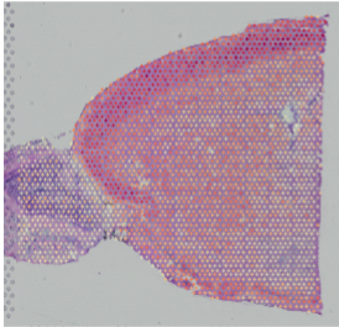{width="25%" fig-align="left"}
:::

::: fragment
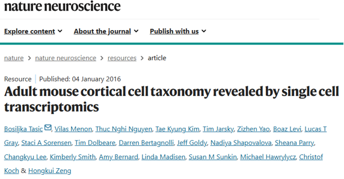{width="60%" fig-align="right"}
:::

## Modos de ajuste

::: fragment
**doublet**: atribui no máximo dois tipos celulares por spot.
:::

::: fragment
**multi**: permite até o limite configurado em MAX_MULTI_TYPES.
:::

::: fragment
**full**: não impõe um número fixo de tipos.
:::

O curso usa o modo *doublet* para manter o custo computacional controlado. A restrição descreve o modelo, não a quantidade real de células no spot.

## Custo computacional

-   A referência do Allen Institute ocupa cerca de 1 GB em disco e aproximadamente 3 GB em memória.
-   A execução validada do RCTD levou 14,22 minutos em um servidor com 30 núcleos e 160Gb de RAM.
-   No Windows, o fluxo original permite utilizar apenas um núcleo.

## Conferir o ambiente

```{r}
#| eval: false
pacotes_rctd <- c(
  "Seurat", "SeuratObject", "SeuratData", "Matrix", "ggplot2", "spacexr"
)

pacotes_rctd_ausentes <- pacotes_rctd[
  !vapply(pacotes_rctd, requireNamespace, logical(1), quietly = TRUE)
]

if (length(pacotes_rctd_ausentes) > 0) {
  stop(
    "Execute primeiro Configuracao_do_ambiente_RStudio.Rmd. ",
    "Pacotes ausentes: ",
    paste(pacotes_rctd_ausentes, collapse = ", ")
  )
}
```

## Diretórios e pacotes

```{r}
#| eval: false
diretorio_vinhetas <- getwd()

diretorio_curso <- dirname(diretorio_vinhetas)
diretorio_dados <- file.path(diretorio_curso, "data")
diretorio_imagens <- file.path(diretorio_curso, "imagens")
diretorio_resultados <- file.path(diretorio_curso, "resultados")

dir.create(diretorio_dados, showWarnings = FALSE, recursive = TRUE)
dir.create(diretorio_imagens, showWarnings = FALSE, recursive = TRUE)
dir.create(diretorio_resultados, showWarnings = FALSE, recursive = TRUE)
```

::: fragment
```{r}
#| eval: false
library("Seurat")
library("SeuratData")
library("Matrix")
library("ggplot2")
library("spacexr")

options(stringsAsFactors = FALSE)
```
:::

## Carregar a amostra espacial

```{r}
#| eval: false
if (!requireNamespace("stxBrain.SeuratData", quietly = TRUE)) {
  stop(
    "O conjunto stxBrain não está instalado.\nExecute primeiro a vinheta ",
    "Configuracao_do_ambiente_RStudio.Rmd: \n",
    "https://flaviogckessler.github.io/Curso_ST/vinhetas/Configuracao_do_ambiente_RStudio.html"
  )
}

message("O conjunto stxBrain já foi instalado.")

stxbrain <- SeuratData::LoadData("stxBrain", type = "anterior1")
stxbrain
```

## Contagens espaciais brutas {.code-result-slide}

```{r}
#| eval: false
contagens_espaciais <- SeuratObject::LayerData(
  object = stxbrain,
  assay = "Spatial",
  layer = "counts"
)

print(paste("Número de spots:",dim(contagens_espaciais)[2]))
print(paste("Número de genes:",dim(contagens_espaciais)[1]))

contagens_espaciais[
   seq_len(min(5L, nrow(contagens_espaciais))),
   seq_len(min(5L, ncol(contagens_espaciais))),
   drop = FALSE]
```

::: {.fragment .expected-output}
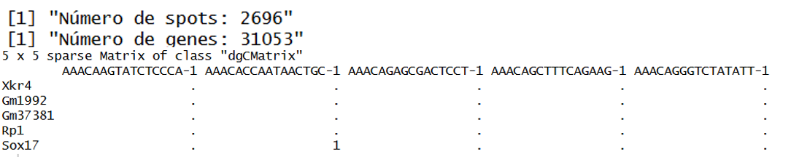{width="82%"}
:::

## Profundidade por spot {.code-result-slide}

```{r}
#| eval: false
summary(Matrix::colSums(contagens_espaciais))
```

::: {.fragment .expected-output}
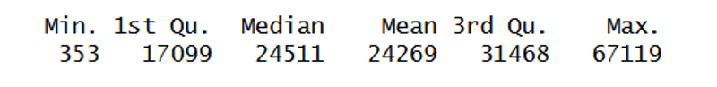{width="62%"}
:::

## Coordenadas dos spots {.code-result-slide}

```{r}
#| eval: false
nome_imagem <- SeuratObject::Images(stxbrain)[1]
coordenadas_espaciais <- SeuratObject::GetTissueCoordinates(
  object = stxbrain,
  image = nome_imagem,
  scale = NULL
)

coordenadas_espaciais <- as.data.frame(
  coordenadas_espaciais[, c("x", "y"), drop = FALSE]
)
coordenadas_espaciais <- coordenadas_espaciais[
  colnames(contagens_espaciais), , drop = FALSE
]

head(coordenadas_espaciais)
```

::: {.fragment .expected-output}
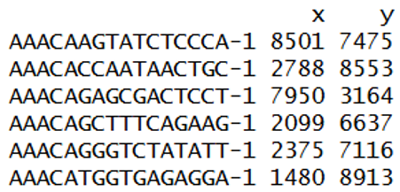{width="72%"}
:::

## Referência single-cell {.code-result-slide}

```{r}
#| eval: false
arquivo_referencia <- file.path(diretorio_dados, "allen_cortex.rds")

if (!file.exists(arquivo_referencia)) {
  stop(
    "A referência single-cell não foi encontrada em: ",
    arquivo_referencia,
    "\nBaixe o arquivo como descrito acima ou copie o arquivo fornecido pelo instrutor para data/."
  )
}

referencia_allen <- readRDS(arquivo_referencia)
metadados_referencia <- referencia_allen[[]]

contagens_referencia <- SeuratObject::LayerData(
  object = referencia_allen,
  assay = "RNA",
  layer = "counts"
)
head(contagens_referencia[,1:5])
```

::: {.fragment .expected-output}
::::: columns
::: {.column width="49%"}
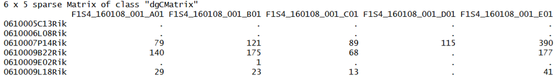{width="100%"}
:::
::: {.column width="49%"}
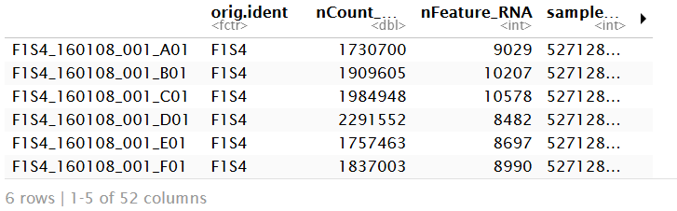{width="100%"}
:::
:::::
:::

## Rótulos e tipos raros {.code-result-slide}

```{r}
#| eval: false
metadados_referencia <- metadados_referencia[
  colnames(contagens_referencia), , drop = FALSE
]

tipos_celulares_referencia <- as.character(
  metadados_referencia$subclass
)
tipos_celulares_referencia <- gsub(
  "/", "-", tipos_celulares_referencia, fixed = TRUE
)

celulas_validas <- !is.na(tipos_celulares_referencia) &
  nzchar(tipos_celulares_referencia)

tamanhos_tipos <- table(tipos_celulares_referencia[celulas_validas])
tipos_elegiveis <- names(tamanhos_tipos[tamanhos_tipos >= 25])
celulas_validas <- celulas_validas &
  tipos_celulares_referencia %in% tipos_elegiveis
```

::: {.fragment .expected-output}
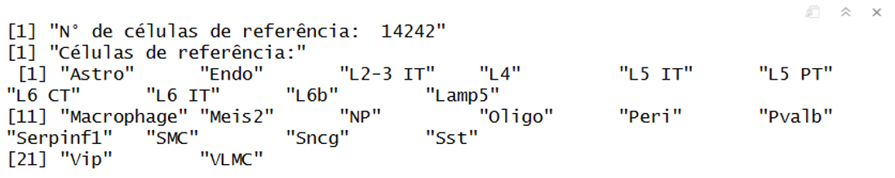{width="84%"}
:::

## Filtrar a matriz da referência

```{r}
#| eval: false
contagens_referencia <- contagens_referencia[
  , celulas_validas, drop = FALSE
]
tipos_celulares_referencia <- droplevels(
  factor(tipos_celulares_referencia[celulas_validas])
)

print(paste("N° de células de referência: ",ncol(contagens_referencia)))
print("Células de referência:")
levels(tipos_celulares_referencia)
```

O filtro padrão mantém somente tipos celulares representados por pelo menos 25 células.

## Genes compartilhados {.code-result-slide}

```{r}
#| eval: false
genes_comuns <- intersect(
  rownames(contagens_espaciais),
  rownames(contagens_referencia)
)

resumo_genes <- data.frame(
  fonte = c("amostra espacial", "referência single-cell", "interseção"),
  numero_de_genes = c(
    nrow(contagens_espaciais),
    nrow(contagens_referencia),
    length(genes_comuns)
  )
)
resumo_genes

contagens_espaciais <- contagens_espaciais[
  genes_comuns, , drop = FALSE
]
contagens_referencia <- contagens_referencia[
  genes_comuns, , drop = FALSE
]
```

::: {.fragment .expected-output}
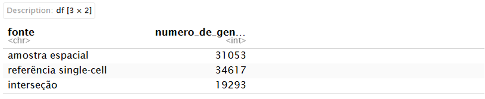{width="62%"}
:::

## Objetos de entrada do spacexr {.code-result-slide}

```{r}
#| eval: false
names(tipos_celulares_referencia) <- colnames(contagens_referencia)

referencia_rctd <- spacexr::Reference(
  contagens_referencia,
  tipos_celulares_referencia,
  Matrix::colSums(contagens_referencia)
)

consulta_rctd <- spacexr::SpatialRNA(
  as.data.frame(coordenadas_espaciais),
  contagens_espaciais,
  Matrix::colSums(contagens_espaciais)
)

data.frame(objeto = c("referencia_rctd", "consulta_rctd"),
  genes = c(nrow(referencia_rctd@counts),nrow(consulta_rctd@counts)),
  unidades = c(ncol(referencia_rctd@counts),ncol(consulta_rctd@counts)),
  tipo_de_unidade = c("células", "spots"))
```

::: {.fragment .expected-output}
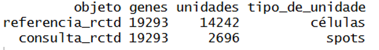{width="70%"}
:::

## Criar e executar o RCTD

```{r}
#| eval: false
set.seed(20260904)

numero_nucleos <- 1

RCTD <- spacexr::create.RCTD(
  consulta_rctd,
  referencia_rctd,
  max_cores = numero_nucleos
)

inicio_rctd <- Sys.time()

RCTD <- spacexr::run.RCTD(
  RCTD,
  doublet_mode = "doublet"
)

fim_rctd <- Sys.time()
tempo_rctd <- fim_rctd - inicio_rctd
tempo_rctd
```

> CUIDADO: Este bloco é o mais pesado da aula, não rode na sua máquina enquanto você não garantir a estrutura necessária.

## Inspecionar os resultados {.code-result-slide}

```{r}
#| eval: false
resultado_spots <- RCTD@results$results_df
pesos_doublet <- as.data.frame(RCTD@results$weights_doublet)
colnames(pesos_doublet) <- c("peso_primeiro_tipo", "peso_segundo_tipo")

resumo_spots_rctd <- cbind(resultado_spots, pesos_doublet)

head(resumo_spots_rctd)
table(resumo_spots_rctd$spot_class)
```

::: {.fragment .expected-output}
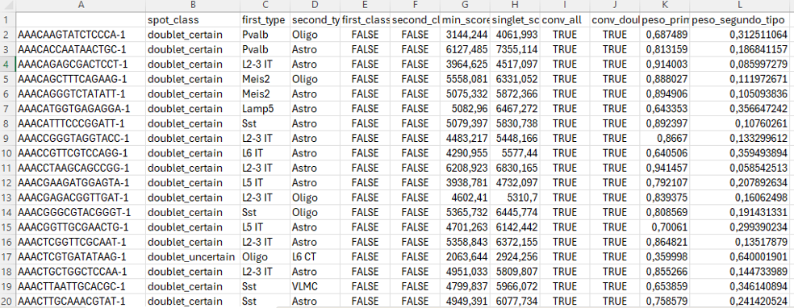{width="92%"}
:::

## Composição das classes

```{r}
#| label: rctd-grafico-classes
#| echo: true
#| fig-width: 9
#| fig-height: 5.2
#| out-width: "76%"
#| fig-align: center
#| output-location: fragment

ggplot(
  tab_classe_rctd,
  aes(x = reorder(classe, spots), y = spots)
) +
  geom_col(fill = "#148F77", width = 0.72) +
  geom_text(
    aes(label = format(spots, big.mark = ".")),
    hjust = -0.12,
    size = 4.8
  ) +
  coord_flip(clip = "off") +
  scale_y_continuous(expand = expansion(mult = c(0, 0.13))) +
  labs(x = NULL, y = "Numero de spots") +
  theme(panel.grid.major.y = element_blank())
```

## Acrescentar as anotações ao Seurat

```{r}
#| eval: false
stxbrain <- SeuratObject::AddMetaData(
  object = stxbrain,
  metadata = resumo_spots_rctd
)
```

As linhas de resumo são alinhadas aos spots pelos códigos de barras.

## Classificação espacial {.code-result-slide}

```{r}
#| eval: false
p_classes <- Seurat::SpatialDimPlot(
  object = stxbrain,
  images = nome_imagem,
  group.by = "spot_class",
  pt.size.factor = 1.6,
  crop = TRUE
) +
  labs(title = "Classificação dos spots pelo RCTD")

p_classes
```

::: {.fragment .expected-output}
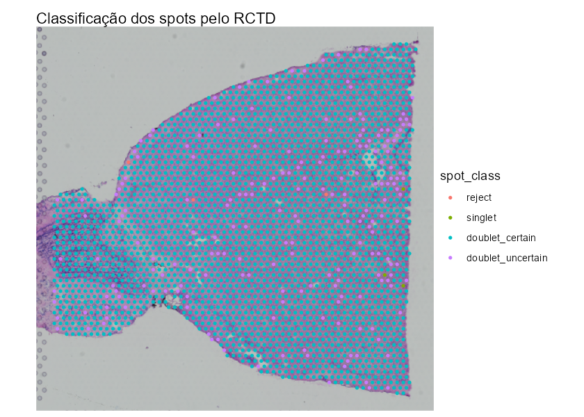{width="72%"}
:::

## Primeiro e segundo tipos celulares {.code-result-slide}

```{r}
#| eval: false
p1 <- Seurat::SpatialDimPlot(
  object = stxbrain,
  images = nome_imagem,
  group.by = "first_type",
  pt.size.factor = 1.6,
  crop = TRUE
) +
  labs(title = "Primeiro tipo celular")

p2 <- Seurat::SpatialDimPlot(
  object = stxbrain,
  images = nome_imagem,
  group.by = "second_type",
  pt.size.factor = 1.6,
  crop = TRUE
) +
  labs(title = "Segundo tipo celular")

p_tipos <- p1 + p2
p_tipos
```

::: {.fragment .expected-output}
{width="88%"}
:::

## Interpretação do modo doublet

-   singlet: um tipo celular confiável.
-   doublet_certain: dois tipos celulares confiáveis.
-   doublet_uncertain: somente o primeiro tipo é confiável.
-   reject: nenhuma atribuição confiável.
-   Os pesos descrevem a composição estimada e dependem da referência usada.

## Salvar resultados reutilizáveis

```{r}
#| eval: false
write.csv(
  resumo_spots_rctd,
  file = file.path(
    diretorio_resultados,
    "stxbrain_RCTD_doublet_spot_summary.csv"
  ),
  row.names = TRUE
)

saveRDS(
  stxbrain,
  file = file.path(
    diretorio_resultados,
    "stxbrain_Seurat_com_RCTD.rds"
  )
)
```

# Comunicação celular {background-color="#0B3B49"}

[Vinheta de referência: **CellChat e PathwaySpace**](../../vinhetas/CellChat_Comunicacao_Celular_PathwaySpace.html)

## Pergunta biológica

O CellChat busca relações entre ligantes expressos por uma população e receptores expressos por outra [@Jin2021CellChat; @Jin2025CellChat].

No tecido, a expressão precisa ser interpretada junto com a proximidade espacial.

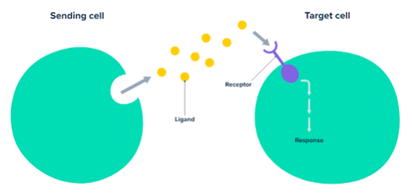{width="68%" fig-align="center"}

## Do cluster ao tecido

1.  Inferir comunicações entre clusters.
2.  Localizar os spots de origem e destino.
3.  Restringir a comunicação a spots espacialmente próximos.
4.  Associar a comunicação às arestas da rede.
5.  Projetar o sinal com PathwaySpace.

## Inferência das redes de comunicação

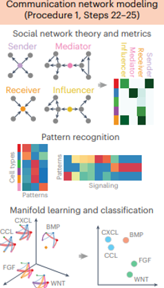{height="62%" fig-align="center"}

## Probabilidade de comunicação

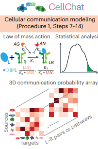{height="62%" fig-align="center"}

## Entrada: expressão e grupos

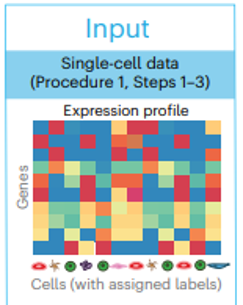{height="62%" fig-align="center"}

## Entrada: interações ligante--receptor

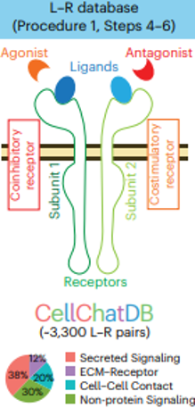{height="62%" fig-align="center"}

## Carregar a seção anterior

```{r}
#| eval: false
brain <- readRDS(file.path(diretorio_dados, "brain.RDS"))
brain <- subset(brain, subset = region == "anterior")

DefaultAssay(brain) <- "SCT"
Idents(brain) <- "seurat_clusters"

if (length(Images(brain)) != 1L) {
  stop("O subset da região anterior deve manter exatamente uma imagem espacial.")
}

nome_imagem <- Images(brain)[1]

brain
table(brain$region)
```

O resultado esperado é um objeto com 2.696 spots e uma única imagem, denominada anterior1.

## Expressão e metadados {.code-result-slide}

```{r}
#| eval: false
data.input <- LayerData(brain, assay = "SCT", layer = "data")
spots_anterior <- Cells(brain[[nome_imagem]])
data.input <- data.input[, spots_anterior, drop = FALSE]

metadados_brain <- brain[[]]

meta <- data.frame(
  labels = paste0("cluster_",
    metadados_brain[colnames(data.input), "seurat_clusters"]),
  samples = nome_imagem,
  row.names = colnames(data.input)
)

meta$labels <- factor(meta$labels)
meta$samples <- factor(meta$samples, levels = nome_imagem)

table(meta$labels, meta$samples)
```

::: {.fragment .expected-output}
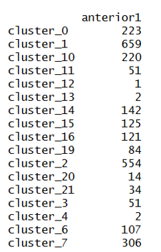{width="58%"}
:::

## Coordenadas e escala física {.code-result-slide}

```{r}
#| eval: false
spatial.locs <- GetTissueCoordinates(
  brain, image = nome_imagem, scale = NULL)
spatial.locs <- as.data.frame(spatial.locs[, c("x", "y"), drop = FALSE])
spatial.locs <- spatial.locs[colnames(data.input), , drop = FALSE]

spot.size <- 55
distancia_centros <- 100
distancias <- computeCellDistance(coordinates = spatial.locs)
menor_distancia <- min(distancias[distancias > 0])

spatial.factors <- data.frame(
  ratio = distancia_centros / menor_distancia,
  tol = spot.size / 2,
  row.names = nome_imagem
)

spatial.factors
head(spatial.locs)
```

::: {.fragment .expected-output}
::::: columns
::: {.column width="68%"}
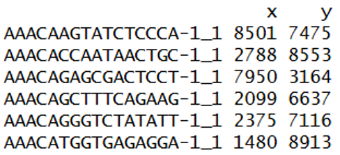{width="100%"}
:::
::: {.column width="30%"}
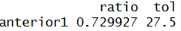{width="100%"}
:::
:::::
:::

## Criar o objeto CellChat {.code-result-slide}

```{r}
#| eval: false
cellchat <- createCellChat(
  object = data.input, meta = meta, group.by = "labels",
  datatype = "spatial", coordinates = spatial.locs,
  spatial.factors = spatial.factors
)

cellchat
```

::: {.fragment .expected-output}
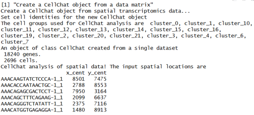{width="82%"}
:::

## Banco de interações {.code-result-slide}

```{r}
#| eval: false
CellChatDB <- CellChatDB.mouse
showDatabaseCategory(CellChatDB)

CellChatDB.use <- subsetDB(CellChatDB,
  search = "Secreted Signaling", key = "annotation")

cellchat@DB <- CellChatDB.use
```

::: {.fragment .expected-output}
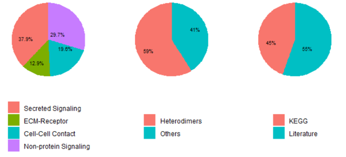{width="68%"}
:::

## Pré-processar e inferir

```{r}
#| eval: false
cellchat <- subsetData(cellchat)

future::plan("multisession", workers = 4)

cellchat <- identifyOverExpressedGenes(cellchat)
cellchat <- identifyOverExpressedInteractions(cellchat, variable.both = FALSE)

cellchat <- computeCommunProb(
  cellchat, type = "triMean", distance.use = TRUE,
  interaction.range = 100, scale.distance = 0.01,
  contact.range = 100, contact.dependent = TRUE,
  contact.knn.k = 6, nboot = 10
)

cellchat <- filterCommunication(cellchat, min.cells = 10)
```

> CUIDADO: Esta é a etapa mais custosa da vinheta. O número de permutações foi limitado a 10 para a atividade didática.

## Comunicações entre clusters {.code-result-slide}

```{r}
#| eval: false
df.net <- subsetCommunication(cellchat, thresh = 0.05)

df.net <- df.net %>%
  mutate(source = as.character(source), target = as.character(target))

head(df.net)
```

::: {.fragment .expected-output}
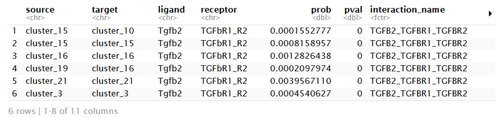{width="94%"}
:::

## Pares de spots próximos {.code-result-slide}

```{r}
#| eval: false
interaction.range <- 100

coordenadas_um <- spatial.locs * spatial.factors[nome_imagem, "ratio"]
matriz_distancias <- as.matrix(dist(coordenadas_um))
diag(matriz_distancias) <- Inf

indices <- which(matriz_distancias <= interaction.range, arr.ind = TRUE)

spot.pairs <- tibble(
  source_spot = rownames(matriz_distancias)[indices[, 1]],
  target_spot = colnames(matriz_distancias)[indices[, 2]],
  distance_um = matriz_distancias[indices],
  sample = nome_imagem
)

spot.groups <- tibble(spot = rownames(cellchat@meta),
  group = as.character(cellchat@idents))
```

::: {.fragment .expected-output}
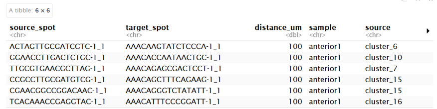{width="86%"}
:::

## Projetar clusters nos pares de spots

```{r}
#| eval: false
spot.pairs <- spot.pairs %>%
  left_join(spot.groups, by = c("source_spot" = "spot")) %>%
  rename(source = group) %>%
  left_join(spot.groups, by = c("target_spot" = "spot")) %>%
  rename(target = group)

head(spot.pairs)
```

Cada par recebe o cluster do spot de origem e o cluster do spot de destino.

## Combinar e salvar as comunicações {.code-result-slide}

```{r}
#| eval: false
spot.to.spot.communication <- spot.pairs %>%
  inner_join(df.net, by = c("source", "target")) %>%
  arrange(sample, source_spot, target_spot,
    pathway_name, interaction_name)

head(spot.to.spot.communication)

saveRDS(
  spot.to.spot.communication,
  file = file.path(diretorio_resultados,
    "spot-spot_commu_anterior.rds")
)
```

::: {.fragment .expected-output}
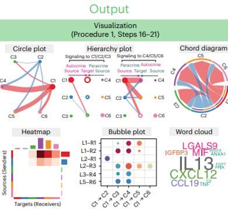{width="88%"}
:::

## Construir o GraphSpace

```{r}
#| eval: false
spots_visualizacao <- spots_anterior

coordenadas_gs <- GetTissueCoordinates(
  brain, image = nome_imagem, scale = "lowres"
)
coordenadas_gs <- coordenadas_gs[
  spots_visualizacao, c("x", "y"), drop = FALSE
]

metadados_gs <- brain[[]][spots_visualizacao, , drop = FALSE]
gs <- GraphSpace(cbind(coordenadas_gs, metadados_gs))

gs_fdata(gs) <- LayerData(
  brain, assay = "SCT", layer = "data"
)[, spots_visualizacao, drop = FALSE]

gs_image(gs) <- GetImage(
  brain[[nome_imagem]], mode = "raster"
)

gs <- normalizeGraphSpace(gs)
```

## Clusters no GraphSpace {.code-result-slide}

```{r}
#| eval: false
spatial_theme <- theme_gspace_coords(
  theme = "th3", is_norm = TRUE,
  xlab = "Coordenada espacial 1", ylab = "Coordenada espacial 2"
)

cpal1 <- DiscretePalette(nlevels(gs$seurat_clusters), "polychrome")

ggplot(gs) +
  annotation_gspace_image(gs) +
  geom_nodespace(mapping = aes(colour = seurat_clusters),
    size = 1, pch = 19) +
  scale_colour_manual(values = cpal1) +
  theme_gspace_legend(discrete_colour = TRUE) +
  spatial_theme
```

::: {.fragment .expected-output}
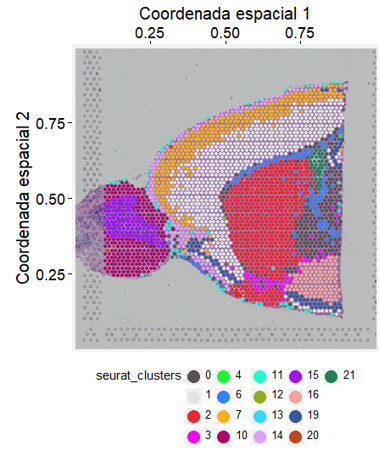{width="72%"}
:::

## Rede de proximidade {.scrollable}

```{r}
#| eval: false
proximityNetwork <- function(gs, nnei = 6) {
  nodes <- gs@nodes

  vizinhos <- RANN::nn2(nodes[, c("x", "y")],
    nodes[, c("x", "y")], k = nnei + 1)

  distancias <- as.data.frame(vizinhos$nn.dists[, 2:(nnei + 1)])
  indices <- as.data.frame(vizinhos$nn.idx[, 2:(nnei + 1)])

  distancia_tipica <- 1 / mean(1 / distancias$V1)
  manter <- distancias
  manter[, 1] <- TRUE
  manter[, 2:ncol(manter)] <-
    distancias[, 2:ncol(distancias)] >= 0.95 * distancia_tipica &
    distancias[, 2:ncol(distancias)] <= 1.05 * distancia_tipica

  matriz_arestas <- manter * indices
  matriz_arestas$from <- row.names(matriz_arestas)

  arestas <- matriz_arestas %>%
    pivot_longer(cols = -from, names_to = "vizinho", values_to = "to") %>%
    filter(to != 0) %>%
    transmute(from = as.numeric(from), to = as.numeric(to),
      v1 = pmin(from, to), v2 = pmax(from, to)) %>%
    distinct(v1, v2) %>%
    transmute(from = nodes$name[v1], to = nodes$name[v2])

  gs_add_edges(gs) <- arestas
  gs
}
```

## Antes da rede de proximidade {.code-result-slide}

```{r}
#| eval: false
ggplot(gs) +
  annotation_gspace_image(gs) +
  geom_edgespace() +
  geom_nodespace(mapping = aes(colour = seurat_clusters),
    size = 3, pch = 19) +
  scale_colour_manual(values = cpal1) +
  theme_gspace_legend(discrete_colour = TRUE) +
  spatial_theme +
  coord_cartesian(xlim = c(0.4, 0.6), ylim = c(0.4, 0.6))
```

::: {.fragment .expected-output}
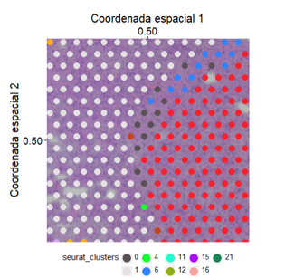{width="70%"}
:::

## Depois da rede de proximidade {.code-result-slide}

```{r}
#| eval: false
gs <- proximityNetwork(gs)

ggplot(gs) +
  annotation_gspace_image(gs) +
  geom_edgespace() +
  geom_nodespace(mapping = aes(colour = seurat_clusters),
    size = 3, pch = 19) +
  scale_colour_manual(values = cpal1) +
  theme_gspace_legend(discrete_colour = TRUE) +
  spatial_theme +
  coord_cartesian(xlim = c(0.4, 0.6), ylim = c(0.4, 0.6))
```

::: {.fragment .expected-output}
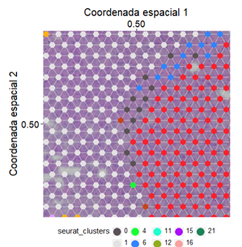{width="70%"}
:::

## Associar comunicação às arestas {.code-result-slide}

```{r}
#| eval: false
arestas <- gs@edges %>% select(name1, name2)

arestas_direcionadas <- bind_rows(
  arestas,
  arestas %>% transmute(name1 = name2, name2 = name1)
) %>%
  distinct()

spotCom_dt <- arestas_direcionadas %>%
  inner_join(
    spot.to.spot.communication %>% filter(sample == nome_imagem),
    by = c("name1" = "source_spot", "name2" = "target_spot")
  )

spotCom_dt$arrowType <- 1

interacoes_disponiveis <- spotCom_dt %>%
  select(ligand, receptor, interaction_name) %>%
  filter(!is.na(ligand), !is.na(receptor)) %>%
  distinct()

head(interacoes_disponiveis)
```

::: {.fragment .expected-output}
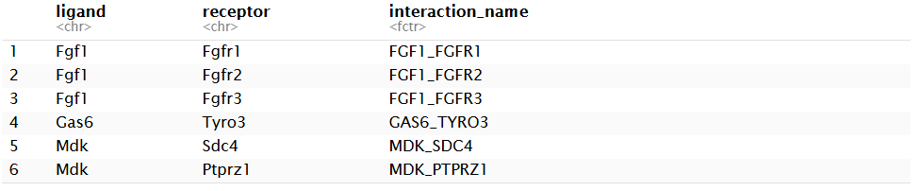{width="72%"}
:::

## Função de projeção espacial {.scrollable}

```{r}
#| eval: false
communication_pathwayspace <- function(gs, lig, recep, spotCom_dt) {
  comunicacoes <- spotCom_dt %>% filter(ligand == lig, receptor == recep)

  spots_selecionados <- unique(c(comunicacoes$name1, comunicacoes$name2))

  gs_selecionado <- gs_subset_nodes(gs, spots_selecionados)
  pspace_obj <- buildPathwaySpace(gs_selecionado)

  distancia_spots <- getNearestNode(pspace_obj)
  pdist <- mean(distancia_spots$dist)

  pspace_obj <- silhouetteMapping(pspace_obj, baseline = 0.1)

  resolver_features <- function(rotulo, features_disponiveis) {
    if (rotulo %in% features_disponiveis) {
      return(rotulo)
    }

    componentes <- strsplit(rotulo, "_", fixed = TRUE)[[1]]
    features_disponiveis[match(tolower(componentes),
      tolower(features_disponiveis))]
  }

  features_disponiveis <- colnames(pspace_obj@fdata)
  features_ligante <- resolver_features(lig, features_disponiveis)
  features_receptor <- resolver_features(recep, features_disponiveis)

  if (anyNA(c(features_ligante, features_receptor))) {
    stop("O ligante ou o receptor não foi encontrado nos dados de expressão.")
  }

  sinal_ligante <- rowSums(as.matrix(
    pspace_obj@fdata[, features_ligante, drop = FALSE]))
  sinal_receptor <- rowSums(as.matrix(
    pspace_obj@fdata[, features_receptor, drop = FALSE]))

  vertexSignal(pspace_obj) <- sinal_ligante + sinal_receptor

  pspace_obj <- circularProjection(
    pspace_obj, decay.fun = weibullDecay(decay = 0.5, pdist = pdist),
    aggregate.fun = signalAggregation("wmean"),
    k = gs_vcount(pspace_obj))

  pspace_obj
}
```

## PathwaySpace: Fgf1--Fgfr1 {.code-result-slide}

```{r}
#| eval: false
pspace_obj <- communication_pathwayspace(
  gs = gs, lig = "Fgf1", recep = "Fgfr1",
  spotCom_dt = spotCom_dt)

grafico_exemplo <- ggplot(pspace_obj) +
  annotation_gspace_image(pspace_obj) +
  annotation_pspace_signal(pspace_obj, si.alpha = 0.25) +
  spatial_theme + labs(title = "Fgf1 - Fgfr1")

grafico_exemplo
```

::: {.fragment .expected-output}
{.cellchat-map fig-align="center"}
:::

## PathwaySpace: Fgf1--Fgfr2 {.code-result-slide}

```{r}
#| eval: false
pspace_obj <- communication_pathwayspace(
  gs = gs, lig = "Fgf1", recep = "Fgfr2",
  spotCom_dt = spotCom_dt)

grafico_exemplo <- ggplot(pspace_obj) +
  annotation_gspace_image(pspace_obj) +
  annotation_pspace_signal(pspace_obj, si.alpha = 0.25) +
  spatial_theme + labs(title = "Fgf1 - Fgfr2")

grafico_exemplo
```

::: {.fragment .expected-output}
{.cellchat-map fig-align="center"}
:::

## PathwaySpace: Fgf1--Fgfr3 {.code-result-slide}

```{r}
#| eval: false
pspace_obj <- communication_pathwayspace(
  gs = gs, lig = "Fgf1", recep = "Fgfr3",
  spotCom_dt = spotCom_dt)

grafico_exemplo <- ggplot(pspace_obj) +
  annotation_gspace_image(pspace_obj) +
  annotation_pspace_signal(pspace_obj, si.alpha = 0.25) +
  spatial_theme + labs(title = "Fgf1 - Fgfr3")

grafico_exemplo
```

::: {.fragment .expected-output}
{.cellchat-map fig-align="center"}
:::

## Comparação entre receptores de Fgf1

-   O ligante é o mesmo, mas a distribuição espacial muda com o receptor.
-   Fgfr1 e Fgfr2 formam domínios projetados mais extensos.
-   Fgfr3 produz uma paisagem mais descontínua, com focos separados.

> A projeção descreve onde a interação é compatível com a rede espacial e com a expressão observada. Ela não demonstra fluxo molecular direto entre células.

## Desafio

**Repita a análise usando tipos celulares inferidos pelo RCTD no lugar dos clusters do Seurat.**

[Vinheta anterior: deconvolução com RCTD](../../vinhetas/RCTD_Deconvolution_stxbrain.html)

# Segmentação celular em Visium HD {background-color="#0B3B49"}

[Vinheta de referência: **segmentação celular em Visium HD**](../../vinhetas/Segmentacao_Celular_VisiumHD.html)

## Visium HD

::::: columns
::: {.column width="48%"}
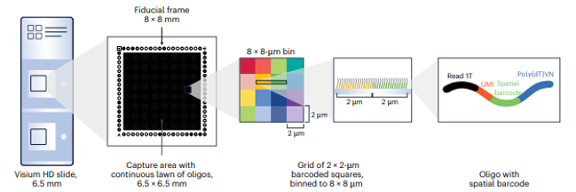{width="100%"}
:::
::: {.column width="50%"}
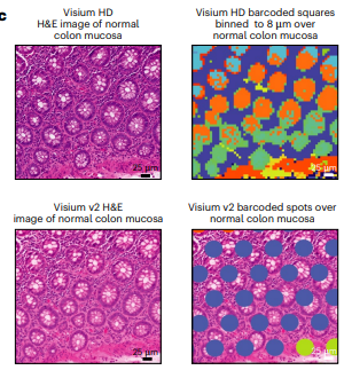{width="100%"}
:::
:::::

## De bins a células

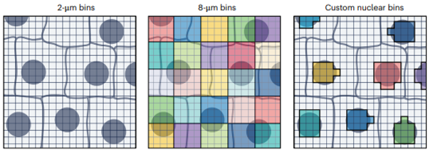{width="88%" fig-align="center"}

## Exemplo de aplicação

![Populações imunes em câncer colorretal analisadas com Visium HD. Fonte: Oliveira et al. (2025) [@DeOliveira2025VisiumHD].](assets/visiumhd-paper.png){width="77%" fig-align="center"}

## Objetivo da prática

-   Inspecionar geometrias celulares já estimadas.
-   Representar cada célula como centro e como polígono.
-   Comparar expressão discreta e sinal espacial contínuo.
-   Integrar RGraphSpace, sf e PathwaySpace.

## Pacotes

```{r}
#| label: segmentacao-pacotes
#| cache: false
library("RGraphSpace")
library("sf")
library("ggplot2")
library("patchwork")
library("PathwaySpace")
```

## Carregar o objeto preparado {.code-result-slide}

```{r}
#| label: segmentacao-carregar
#| cache: false
#| output-location: fragment
arquivo_dados <- file.path(diretorio_dados, "VisiumHD_GS_Crop.RDS")

gs_crop <- readRDS(arquivo_dados)

if (!inherits(gs_crop, "GraphSpace")) {
  stop("O arquivo baixado não contém um objeto da classe GraphSpace.")}

gs_crop
```

## Geometrias celulares {.code-result-slide}

```{r}
#| label: segmentacao-geometrias
#| cache: false
#| output-location: fragment
gs_crop@nodes$cellseg

geometrias_celulares <- gs_crop@nodes$cellseg

length(geometrias_celulares)
sf::st_geometry_type(geometrias_celulares) |> table()
```

## Células individuais {.code-result-slide}

```{r}
#| label: segmentacao-celulas-individuais
#| cache: false
#| fig-show: hold
#| out-width: "31%"
#| fig-width: 4
#| fig-height: 4
#| output-location: fragment
plot(gs_crop@nodes$cellseg[1])
plot(gs_crop@nodes$cellseg[2])
plot(gs_crop@nodes$cellseg[3])
```

## Primeiras vinte geometrias {.code-result-slide}

```{r}
#| label: segmentacao-combinar
#| cache: false
#| fig-width: 6
#| fig-height: 6
#| out-width: "58%"
#| fig-align: center
#| output-location: fragment
plot(st_combine(gs_crop@nodes$cellseg[1:20]))
```

## Escala comum para PIGR

```{r}
#| label: segmentacao-escala
#| cache: false
cpal <- hcl.colors(100, palette = "Geyser", rev = FALSE)
data_range <- range(log2(gs_crop[["fdata"]] + 1))
```

A mesma transformação, paleta e limites serão usados nos painéis seguintes.

## Limites sobre a imagem {.code-result-slide}

```{r}
#| label: segmentacao-limites
#| cache: false
#| fig-width: 7
#| fig-height: 6
#| out-width: "58%"
#| fig-align: center
#| output-location: fragment
p_nodes <- ggplot(gs_crop) +
  annotation_gspace_image(gs_crop, opacity = 1) +
  geom_sf( aes(geometry = cellseg), fill = NA,
    linewidth = 0.3, colour = "cyan") +
  geom_nodespace(colour = "black", size = 0.1, pch = 19) +
  scale_fill_continuous(palette = cpal, limits = data_range) +
  theme_gspace_coords(
    theme = "th3",is_norm = TRUE,
    xlab = "Coordenada do tecido 1",
    ylab = "Coordenada do tecido 2")
p_nodes
```

## Células como vértices {.code-result-slide}

```{r}
#| label: segmentacao-vertices
#| cache: false
#| fig-width: 7
#| fig-height: 6
#| out-width: "58%"
#| fig-align: center
#| output-location: fragment
p1 <- ggplot(gs_crop) +
  annotation_gspace_image(gs_crop, opacity = 1) +
  geom_nodespace(
    mapping = aes(colour = log2(PIGR + 1)),
    size = 1.5,pch = 19) +
  scale_colour_continuous(palette = cpal, limits = data_range) +
  theme_gspace_coords(
    theme = "th3",is_norm = TRUE,
    xlab = "Coordenada do tecido 1",
    ylab = "Coordenada do tecido 2")

p1
```

## Células como polígonos {.code-result-slide}

```{r}
#| label: segmentacao-poligonos
#| cache: false
#| fig-width: 7
#| fig-height: 6
#| out-width: "58%"
#| fig-align: center
#| output-location: fragment
p2 <- ggplot(gs_crop) +
  annotation_gspace_image(gs_crop, opacity = 1) +
  geom_sf(
    mapping = aes(
      geometry = cellseg,
      fill = log2(PIGR + 1))) +
  scale_fill_continuous(palette = cpal, limits = data_range) +
  geom_nodespace(colour = "black", size = 0.2, pch = 19) +
  theme_gspace_coords(
    theme = "th3",is_norm = TRUE,
    xlab = "Coordenada do tecido 1",
    ylab = "Coordenada do tecido 2")

p2
```

## Centros e polígonos {.code-result-slide}

```{r}
#| label: segmentacao-comparacao
#| cache: false
#| fig-width: 12
#| fig-height: 6
#| out-width: "78%"
#| fig-align: center
#| output-location: fragment
p <- p1 + p2 +
  patchwork::plot_annotation(
    title = "Integração do RGraphSpace com geometrias sf",
    theme = theme(plot.title = element_text(hjust = 0.5)))
p
```

## Construir o PathwaySpace

```{r}
#| label: segmentacao-pathwayspace
#| cache: false
pspace_obj <- buildPathwaySpace(gs_crop, nrc = 700)

nspot <- getNearestNode(pspace_obj)
pdist <- mean(nspot$dist) # distância média
pdist
```

## Silhueta de projeção {.code-result-slide}

```{r}
#| label: segmentacao-silhueta
#| cache: false
#| fig-width: 7
#| fig-height: 6
#| out-width: "58%"
#| fig-align: center
#| output-location: fragment
pspace_obj <- silhouetteMapping(pspace_obj, fill.cavity = FALSE, baseline = 0.03, pdist = max(nspot$dist))

ggplot(pspace_obj) +
  annotation_gspace_image(pspace_obj) +
  annotation_pspace_signal(pspace_obj, si.alpha = 0.5) +
  theme_gspace_coords(
    theme = "th3",is_norm = TRUE,
    xlab = "Coordenada do tecido 1",
    ylab = "Coordenada do tecido 2")
```

## Projetar PIGR

```{r}
#| label: segmentacao-projecao
#| cache: false
activeFeature(pspace_obj) <- "PIGR"

pspace_obj <- circularProjection(pspace_obj, k = gs_vcount(pspace_obj),
                                 decay.fun = weibullDecay(decay=0.5, pdist = pdist))
```

## Polígono e sinal contínuo {.code-result-slide}

```{r}
#| label: segmentacao-painel-final
#| cache: false
#| fig-width: 12
#| fig-height: 6
#| out-width: "78%"
#| fig-align: center
#| output-location: fragment
p3 <- ggplot(pspace_obj) +
  annotation_gspace_image(pspace_obj) +
  annotation_pspace_signal(pspace_obj, si.alpha = 0, title = "") +
  geom_sf(
    aes(
      geometry = cellseg
    ),
    alpha = 0,
    linewidth = 0.3,
    colour = "white"
  ) +
  geom_nodespace(
    colour = "black",
    size = 0.1,
    pch = 19
  ) +
  theme_gspace_coords(
    theme = "th3",is_norm = TRUE,
    xlab = "Coordenada do tecido 1",
    ylab = "Coordenada do tecido 2")

p_comp <- p2 + p3 +
  patchwork::plot_annotation(
    title = "Integração do RGraphSpace com PathwaySpace",
    theme = theme(plot.title = element_text(hjust = 0.5)))
p_comp
```

## Leitura da comparação

-   Os vértices resumem a posição de cada célula.
-   Os polígonos preservam forma e área.
-   A projeção contínua distribui o sinal entre os centros.
-   O GraphSpace mantém expressão, posição e geometria alinhadas [@RGraphSpace2026].

# Referências e análises downstream {background-color="#0B3B49"}

## Anotação de tipos celulares

| Método | Pergunta central | Referência |
|------------------------|------------------------|------------------------|
| RCTD | quais tipos compõem cada spot? | @Cable2022RCTD |
| cell2location | qual abundância espacial de tipos finos? | @Kleshchevnikov2022Cell2location |

Os dois métodos dependem de uma referência anotada e de compatibilidade entre a referência e o tecido.

## Genes espacialmente variáveis

{width="88%" fig-align="center"}

-   SpatialDE modela padrões espaciais com processos gaussianos [@Svensson2018SpatialDE].
-   nnSVG usa aproximações por vizinhos para ganhar escala [@Weber2023NnSVG].
-   SPARK-X testa padrões espaciais sem um modelo paramétrico rígido [@Zhu2021SPARKX].

## Microambientes teciduais

{height="64%" fig-align="center"}

## Modelos de microambientes

-   NCEM modela comunicação em grafos celulares [@Fischer2023NCEM].
-   Cottrazm reconstrói o microambiente tumoral ao longo do eixo maligno, borda e não maligno [@Xun2023TumorMicroenvironment].

## Ecossistemas integrados

**Squidpy**

-   grafos espaciais, estatísticas de vizinhança e imagens;
-   integração com o ecossistema Scanpy [@Palla2022Squidpy].

**Giotto**

-   visualização, domínios, vizinhanças e comunicação;
-   fluxo integrado para dados espaciais [@Dries2021Giotto].

## Alinhamento e reconstrução 3D

::::: columns
::: {.column width="76%"}
{width="100%"}
:::

::: {.column width="24%"}
{width="100%"}
:::
:::::

STAIR combina alinhamento espacial e integração entre fatias [@Yu2025STAIR].

## Do 3D ao 4D

::::: columns
::: {.column width="55%"}
{width="100%"}
:::

::: {.column width="45%"}
{width="100%"}
:::
:::::

O 4D incorpora dinâmica temporal à reconstrução espacial [@Reynolds2025FourD].

## Comparar plataformas antes do experimento

{width="78%" fig-align="center"}

A escolha depende de resolução, área, sensibilidade, compatibilidade com histologia e custo [@You2024SpatialMethods].

## Guia prático de decisão

| Pergunta | Unidade de análise | Famílias de métodos |
|------------------------|------------------------|------------------------|
| composição celular | spot ou célula | RCTD, cell2location |
| padrão espacial de genes | gene e coordenadas | SpatialDE, nnSVG, SPARK-X |
| nichos e microambientes | grafo espacial | NCEM, Cottrazm |
| ecossistema completo | objeto multimodal | Squidpy, Giotto |
| reconstrução entre cortes | fatia e volume | STAIR |
| dinâmica espaço-temporal | tecido ao longo do tempo | perfilamento 4D |

## Fronteiras da área

{width="94%" fig-align="center"}

## Leituras recomendadas

Material complementar do curso:

[flaviogckessler.github.io/CursoST_EscolaOmicas/apresentacoes/LEITURA_RECOMENDADA.html](https://flaviogckessler.github.io/CursoST_EscolaOmicas/apresentacoes/LEITURA_RECOMENDADA.html)

Priorize a leitura da documentação do método, do artigo original e de benchmarks independentes.

## Créditos

SysbioLab, Laboratório de Bioinformática e Biologia de Sistemas, UFPR

-   Prof. Dr. Mauro Antônio Alves Castro
-   Jonathan André Back
-   Lana Bazan Peters Querne
-   Flávio Gabriel Carazza-Kessler

[github.com/sysbiolab](https://github.com/sysbiolab)\
[bioinfo.ufpr.br](https://bioinfo.ufpr.br)

## Obrigado

Dúvidas?

## Referências citadas {#refs .scrollable}
