```{r}
#| label: aula03-configuracao
#| include: false
#| cache: false

options(
  stringsAsFactors = FALSE,
  width = 100,
  dplyr.summarise.inform = FALSE
)

diretorio_aula <- normalizePath(
  getwd(),
  winslash = "/",
  mustWork = TRUE
)

diretorio_curso <- normalizePath(
  file.path(diretorio_aula, "../.."),
  winslash = "/",
  mustWork = TRUE
)

diretorio_dados <- file.path(diretorio_curso, "data")
diretorio_resultados <- file.path(diretorio_curso, "resultados")
diretorio_imagens <- file.path(diretorio_curso, "imagens")

arquivo_obrigatorio <- function(...) {
  caminho <- file.path(...)
  if (!file.exists(caminho)) {
    stop("Arquivo obrigatório não encontrado: ", caminho)
  }
  caminho
}

suppressPackageStartupMessages({
  library("ggplot2")
  library("knitr")
})

theme_set(
  theme_minimal(base_size = 15) +
    theme(
      plot.title = element_text(face = "bold", colour = "#0B3B49"),
      legend.position = "right"
    )
)
```

# Abertura {background-color="#0B3B49"}

## Roteiro da aula

1. Deconvolução de spots Visium com RCTD
2. Comunicação célula-célula com CellChat e PathwaySpace
3. Segmentação celular em Visium HD
4. Referências e possibilidades de análise downstream

## Estratégia de compilação

| Bloco | O que a apresentação executa | O que permanece como demonstração |
|---|---|---|
| RCTD | leitura dos resultados, sumários e mapas | preparação da referência e ajuste completo |
| CellChat | leitura das comunicações, tabelas e gráficos | inferência ligante-receptor no objeto de 1 GB |
| Visium HD | inspeção, geometrias, gráficos e projeção | somente o salvamento externo das figuras |

> A apresentação usa resultados pré-processados quando a execução completa seria incompatível com uma aula ou com um build previsível.

## Encadeamento analítico

::: {.columns}
::: {.column width="31%"}
**Composição**

Quais tipos celulares contribuem para cada spot?

RCTD
:::
::: {.column width="31%"}
**Comunicação**

Quais pares ligante-receptor conectam regiões vizinhas?

CellChat + PathwaySpace
:::
::: {.column width="31%"}
**Forma celular**

Como limites celulares mudam a representação espacial?

Visium HD + geometrias sf
:::
:::

# Deconvolução com RCTD {background-color="#0B3B49"}

## Por que deconvoluir spots

- Um spot Visium contém RNA de várias células.
- A expressão observada mistura perfis de tipos celulares diferentes.
- Uma referência single-cell anotada fornece os perfis de expressão esperados.
- O RCTD estima a contribuição dos tipos celulares para cada spot [@Cable2022RCTD].

## Modelo conceitual do RCTD

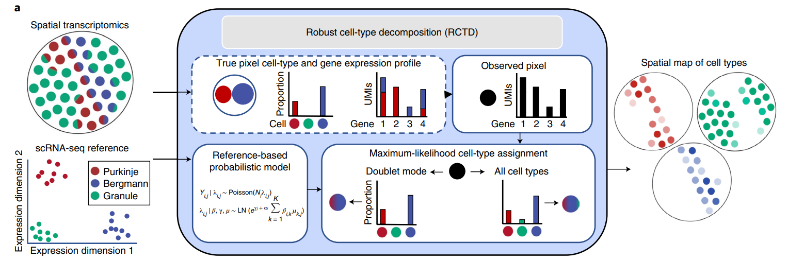{width="96%" fig-align="center"}

## Entradas e saída

| Componente | Objeto | Informação usada |
|---|---|---|
| amostra espacial | stxBrain anterior1 | contagens brutas e coordenadas |
| referência | córtex de camundongo do Allen Institute | contagens brutas e tipo celular |
| resultado | objeto RCTD | classe do spot, tipos e pesos |

As duas matrizes precisam usar identificadores gênicos compatíveis e contagens inteiras.

## Modos de ajuste

::: {.fragment}
**doublet**: atribui no máximo dois tipos celulares por spot.
:::

::: {.fragment}
**multi**: permite até o limite configurado em MAX_MULTI_TYPES.
:::

::: {.fragment}
**full**: não impõe um número fixo de tipos.
:::

O curso usa o modo doublet para manter o custo computacional controlado. A restrição descreve o modelo, não a quantidade real de células no spot.

## Custo computacional

- A referência do Allen Institute ocupa cerca de 1 GB em disco e aproximadamente 3 GB em memória.
- A execução validada do RCTD levou 14,22 minutos em um servidor com 30 núcleos.
- No Windows, o fluxo original usa um núcleo.
- O build desta aula não recalcula o modelo.

## Conferir o ambiente

```{r}
#| label: rctd-pacotes-demonstracao
#| eval: false

pacotes_rctd <- c(
  "Seurat", "SeuratObject", "SeuratData",
  "Matrix", "ggplot2", "spacexr"
)

ausentes <- pacotes_rctd[
  !vapply(pacotes_rctd, requireNamespace, logical(1), quietly = TRUE)
]

if (length(ausentes) > 0) {
  stop("Pacotes ausentes: ", paste(ausentes, collapse = ", "))
}
```

## Carregar a amostra espacial

```{r}
#| label: rctd-carregar-stxbrain-demonstracao
#| eval: false

library("Seurat")
library("SeuratData")

stxbrain <- SeuratData::LoadData(
  "stxBrain",
  type = "anterior1"
)
```

## Contagens brutas

```{r}
#| label: rctd-contagens-demonstracao
#| eval: false

contagens_espaciais <- SeuratObject::LayerData(
  object = stxbrain,
  assay = "Spatial",
  layer = "counts"
)

dim(contagens_espaciais)
summary(Matrix::colSums(contagens_espaciais))
```

O RCTD recebe a camada counts. Dados normalizados por NormalizeData ou SCTransform não devem substituir as contagens brutas.

## Coordenadas dos spots

```{r}
#| label: rctd-coordenadas-demonstracao
#| eval: false

nome_imagem <- SeuratObject::Images(stxbrain)[1]

coordenadas <- SeuratObject::GetTissueCoordinates(
  object = stxbrain,
  image = nome_imagem,
  scale = NULL
)

coordenadas <- as.data.frame(
  coordenadas[, c("x", "y"), drop = FALSE]
)

coordenadas <- coordenadas[
  colnames(contagens_espaciais),
  ,
  drop = FALSE
]
```

## Referência single-cell

```{r}
#| label: rctd-referencia-download-demonstracao
#| eval: false

arquivo_referencia <- file.path(
  diretorio_dados,
  "allen_cortex.rds"
)

referencia_allen <- readRDS(arquivo_referencia)

contagens_referencia <- SeuratObject::LayerData(
  referencia_allen,
  assay = "RNA",
  layer = "counts"
)

metadados_referencia <- referencia_allen[[]]
```

## Rótulos e tipos raros

```{r}
#| label: rctd-filtrar-referencia-demonstracao
#| eval: false

tipos <- as.character(metadados_referencia$subclass)
tipos <- gsub("/", "-", tipos, fixed = TRUE)

validas <- !is.na(tipos) & nzchar(tipos)
tamanhos <- table(tipos[validas])
tipos_elegiveis <- names(tamanhos[tamanhos >= 25])
validas <- validas & tipos %in% tipos_elegiveis

contagens_referencia <- contagens_referencia[, validas]
tipos <- droplevels(factor(tipos[validas]))
```

O filtro mantém tipos celulares com pelo menos 25 células na referência.

## Genes compartilhados

```{r}
#| label: rctd-genes-demonstracao
#| eval: false

genes_comuns <- intersect(
  rownames(contagens_espaciais),
  rownames(contagens_referencia)
)

contagens_espaciais <- contagens_espaciais[genes_comuns, ]
contagens_referencia <- contagens_referencia[genes_comuns, ]
```

Na execução de referência, a interseção contém mais de 19 mil genes.

## Objetos de entrada

```{r}
#| label: rctd-objetos-demonstracao
#| eval: false

names(tipos) <- colnames(contagens_referencia)

referencia_rctd <- spacexr::Reference(
  contagens_referencia,
  tipos,
  Matrix::colSums(contagens_referencia)
)

consulta_rctd <- spacexr::SpatialRNA(
  coordenadas,
  contagens_espaciais,
  Matrix::colSums(contagens_espaciais)
)
```

## Ajuste completo

```{r}
#| label: rctd-ajuste-demonstracao
#| eval: false

set.seed(20260904)

RCTD <- spacexr::create.RCTD(
  consulta_rctd,
  referencia_rctd,
  max_cores = 1
)

RCTD <- spacexr::run.RCTD(
  RCTD,
  doublet_mode = "doublet"
)
```

Este bloco aparece para documentar a reprodução, mas não é executado na compilação.

## Resultados pré-computados

```{r}
#| label: rctd-carregar-resumo

arquivo_resumo_rctd <- arquivo_obrigatorio(
  diretorio_resultados,
  "stxbrain_RCTD_doublet_spot_summary.csv"
)

resumo_rctd <- read.csv(
  arquivo_resumo_rctd,
  row.names = 1,
  check.names = FALSE
)

tab_classe_rctd <- as.data.frame(
  table(resumo_rctd$spot_class),
  stringsAsFactors = FALSE
)

names(tab_classe_rctd) <- c("classe", "spots")
tab_classe_rctd <- tab_classe_rctd[
  order(tab_classe_rctd$spots, decreasing = TRUE),
]

knitr::kable(tab_classe_rctd, row.names = FALSE)
```

## Composição das classes

```{r}
#| label: rctd-grafico-classes
#| fig-width: 9
#| fig-height: 4.8
#| out-width: "90%"

ggplot(
  tab_classe_rctd,
  aes(x = reorder(classe, spots), y = spots)
) +
  geom_col(fill = "#148F77", width = 0.72) +
  geom_text(
    aes(label = format(spots, big.mark = ".")),
    hjust = -0.12,
    size = 4.8
  ) +
  coord_flip(clip = "off") +
  scale_y_continuous(expand = expansion(mult = c(0, 0.13))) +
  labs(x = NULL, y = "Numero de spots") +
  theme(panel.grid.major.y = element_blank())
```

Dos 2.696 spots, 2.483 receberam a classe doublet_certain.

## Tabela de anotações

```{r}
#| label: rctd-tabela-resultados

colunas_rctd <- c(
  "spot_class",
  "first_type",
  "second_type",
  "peso_primeiro_tipo",
  "peso_segundo_tipo"
)

knitr::kable(
  head(resumo_rctd[, colunas_rctd], 6),
  row.names = FALSE,
  digits = 3
)
```

## Mapa calculado no build

```{r}
#| label: rctd-mapa-executado
#| fig-width: 12
#| fig-height: 5
#| out-width: "100%"

suppressPackageStartupMessages({
  library("Seurat")
  library("patchwork")
})

arquivo_seurat_rctd <- arquivo_obrigatorio(
  diretorio_resultados,
  "stxbrain_Seurat_com_RCTD.rds"
)

stxbrain_rctd <- readRDS(arquivo_seurat_rctd)

p_classe <- SpatialDimPlot(
  stxbrain_rctd,
  group.by = "spot_class",
  pt.size.factor = 1.25
) + ggtitle("Classe do spot")

p_tipo <- SpatialDimPlot(
  stxbrain_rctd,
  group.by = "first_type",
  pt.size.factor = 1.25
) + ggtitle("Primeiro tipo celular")

p_classe + p_tipo
```

## Primeiro e segundo tipo celular

::: {.columns}
::: {.column width="50%"}
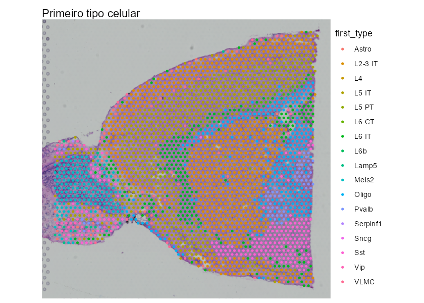{width="100%"}
:::
::: {.column width="50%"}
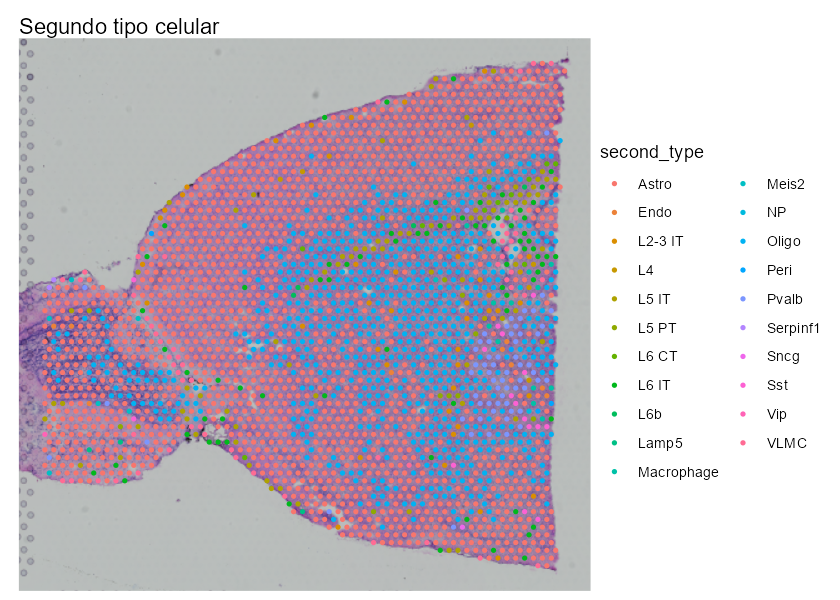{width="100%"}
:::
:::

## Composição celular no tecido

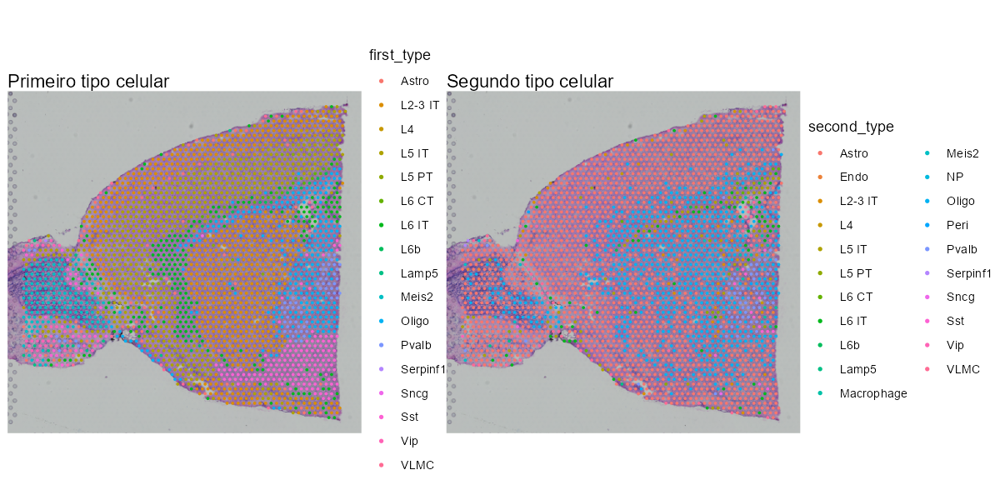{width="88%" fig-align="center"}

## Interpretação do modo doublet

- singlet: um tipo celular confiável.
- doublet_certain: dois tipos celulares confiáveis.
- doublet_uncertain: somente o primeiro tipo é confiável.
- reject: nenhuma atribuição confiável.
- Os pesos descrevem a composição estimada e dependem da referência usada.

```{r}
#| label: rctd-liberar-memoria
#| include: false

rm(stxbrain_rctd, p_classe, p_tipo)
invisible(gc())
```

# Comunicação celular {background-color="#0B3B49"}

## Pergunta biológica

O CellChat busca relações entre ligantes expressos por uma população e receptores expressos por outra [@Jin2021CellChat; @Jin2025CellChat].

No espacial, a expressão não basta. A distância entre as populações também precisa ser representada.

## Do cluster ao tecido

1. Inferir comunicações entre clusters.
2. Localizar os spots de origem e destino.
3. Restringir a comunicação a spots espacialmente próximos.
4. Associar a comunicação às arestas da rede.
5. Projetar o sinal com PathwaySpace.

## Entradas do CellChat

```{r}
#| label: cellchat-entradas-demonstracao
#| eval: false

brain <- readRDS(
  file.path(diretorio_dados, "brain.RDS")
)

dados_expressao <- SeuratObject::LayerData(
  brain,
  assay = "Spatial",
  layer = "data"
)

metadados <- brain[[]]
metadados$labels <- brain$seurat_clusters
```

O objeto completo tem aproximadamente 1 GB. Por isso, a inferência não é repetida no build.

## Coordenadas e escala física

```{r}
#| label: cellchat-coordenadas-demonstracao
#| eval: false

coordenadas <- SeuratObject::GetTissueCoordinates(
  brain,
  image = "anterior1",
  scale = NULL
)

fatores_espaciais <- data.frame(
  ratio = 1,
  tol = 55
)
```

O intervalo de interação por contato e a rede de proximidade usam a escala física do Visium, com centros de spots separados por aproximadamente 100 micrômetros.

## Criar o objeto

```{r}
#| label: cellchat-criar-demonstracao
#| eval: false

cellchat <- createCellChat(
  object = dados_expressao,
  meta = metadados,
  group.by = "labels",
  datatype = "spatial",
  coordinates = coordenadas,
  spatial.factors = fatores_espaciais
)

CellChatDB <- CellChatDB.mouse
CellChatDB.use <- subsetDB(
  CellChatDB,
  search = "Secreted Signaling"
)

cellchat@DB <- CellChatDB.use
```

## Pré-processamento e inferência

```{r}
#| label: cellchat-inferencia-demonstracao
#| eval: false

cellchat <- subsetData(cellchat)
cellchat <- identifyOverExpressedGenes(cellchat)
cellchat <- identifyOverExpressedInteractions(cellchat)

cellchat <- computeCommunProb(
  cellchat,
  type = "triMean",
  distance.use = TRUE,
  interaction.range = 100,
  contact.range = 100
)

cellchat <- filterCommunication(
  cellchat,
  min.cells = 10
)
```

## Projetar clusters para pares de spots

```{r}
#| label: cellchat-spots-demonstracao
#| eval: false

comunicacoes_cluster <- subsetCommunication(cellchat)

interaction.range <- 100

coordenadas_um <- spatial.locs *
  spatial.factors[nome_imagem, "ratio"]

matriz_distancias <- as.matrix(
  dist(coordenadas_um)
)
diag(matriz_distancias) <- Inf

indices <- which(
  matriz_distancias <= interaction.range,
  arr.ind = TRUE
)

spot.pairs <- tibble(
  source_spot = rownames(matriz_distancias)[indices[, 1]],
  target_spot = colnames(matriz_distancias)[indices[, 2]],
  distance_um = matriz_distancias[indices],
  sample = nome_imagem
)

spot.groups <- tibble(
  spot = rownames(cellchat@meta),
  group = as.character(cellchat@idents)
)

spot.pairs <- spot.pairs |>
  left_join(
    spot.groups,
    by = c("source_spot" = "spot")
  ) |>
  rename(source = group) |>
  left_join(
    spot.groups,
    by = c("target_spot" = "spot")
  ) |>
  rename(target = group)

spot.to.spot.communication <- spot.pairs |>
  inner_join(
    comunicacoes_cluster,
    by = c("source", "target")
  ) |>
  arrange(
    sample,
    source_spot,
    target_spot,
    pathway_name,
    interaction_name
  )

saveRDS(
  spot.to.spot.communication,
  file.path(
    diretorio_resultados,
    "spot-spot_commu_anterior.rds"
  )
)
```

## Resultado reutilizável

```{r}
#| label: cellchat-carregar-resultados

suppressPackageStartupMessages({
  library("dplyr")
})

arquivo_comunicacoes <- arquivo_obrigatorio(
  diretorio_resultados,
  "spot-spot_commu_anterior.rds"
)

comunicacoes <- readRDS(arquivo_comunicacoes)

resumo_cellchat <- data.frame(
  metrica = c(
    "linhas",
    "pares direcionados de spots",
    "interações ligante-receptor",
    "vias"
  ),
  valor = c(
    nrow(comunicacoes),
    n_distinct(paste(
      comunicacoes$source_spot,
      comunicacoes$target_spot,
      sep = "::"
    )),
    n_distinct(comunicacoes$interaction_name),
    n_distinct(comunicacoes$pathway_name)
  )
)

knitr::kable(resumo_cellchat, row.names = FALSE)
```

## Interações mais frequentes

```{r}
#| label: cellchat-top-interacoes

top_interacoes <- comunicacoes |>
  mutate(
    par = paste(ligand, receptor, sep = " - ")
  ) |>
  group_by(par, pathway_name) |>
  summarise(
    pares_de_spots = n(),
    probabilidade_media = mean(prob, na.rm = TRUE),
    .groups = "drop"
  ) |>
  arrange(desc(pares_de_spots), desc(probabilidade_media)) |>
  slice_head(n = 10)

knitr::kable(
  top_interacoes,
  row.names = FALSE,
  digits = 4
)
```

## Frequência nos pares de spots

```{r}
#| label: cellchat-grafico-top
#| fig-width: 9
#| fig-height: 5.6
#| out-width: "92%"

ggplot(
  top_interacoes,
  aes(
    x = reorder(par, pares_de_spots),
    y = pares_de_spots,
    fill = pathway_name
  )
) +
  geom_col(width = 0.76) +
  coord_flip() +
  scale_fill_brewer(palette = "Set2") +
  labs(
    x = NULL,
    y = "Pares de spots",
    fill = "Via"
  ) +
  theme(panel.grid.major.y = element_blank())
```

## Rede espacial no GraphSpace

```{r}
#| label: cellchat-graphspace-demonstracao
#| eval: false

gs <- as.GraphSpace(
  brain,
  space = "spatial",
  scale = "lowres"
)

gs_image(gs) <- SeuratObject::GetImage(
  brain,
  mode = "raster"
)

gs <- normalizeGraphSpace(
  gs,
  swap.xy = TRUE
)

gs <- proximityNetwork(gs)
```

Cada nó representa um spot. As arestas registram relações de proximidade usadas para filtrar as comunicações possíveis.

## Comunicação direcionada nas arestas

```{r}
#| label: cellchat-associar-demonstracao
#| eval: false

arestas <- gs@edges |>
  select(name1, name2)

arestas_direcionadas <- bind_rows(
  arestas,
  arestas |>
    transmute(name1 = name2, name2 = name1)
) |>
  distinct()

spotCom_dt <- arestas_direcionadas |>
  inner_join(
    comunicacoes,
    by = c(
      "name1" = "source_spot",
      "name2" = "target_spot"
    )
  )
```

## Projeção ligante-receptor

O PathwaySpace projeta o sinal da rede ao longo de caminhos geodésicos e aplica decaimento espacial [@Tercan2025PathwaySpace].

```{r}
#| label: cellchat-pathwayspace-demonstracao
#| eval: false

gs_selecionado <- gs_subset_nodes(
  gs,
  spots_selecionados
)

pspace_obj <- buildPathwaySpace(gs_selecionado)
pspace_obj <- silhouetteMapping(
  pspace_obj,
  baseline = 0.1
)

vertexSignal(pspace_obj) <- sinal_ligante + sinal_receptor

pspace_obj <- circularProjection(
  pspace_obj,
  decay.fun = weibullDecay(
    decay = 0.5,
    pdist = pdist
  ),
  aggregate.fun = signalAggregation("wmean"),
  k = gs_vcount(pspace_obj)
)
```

## Fgf1 e Fgfr1

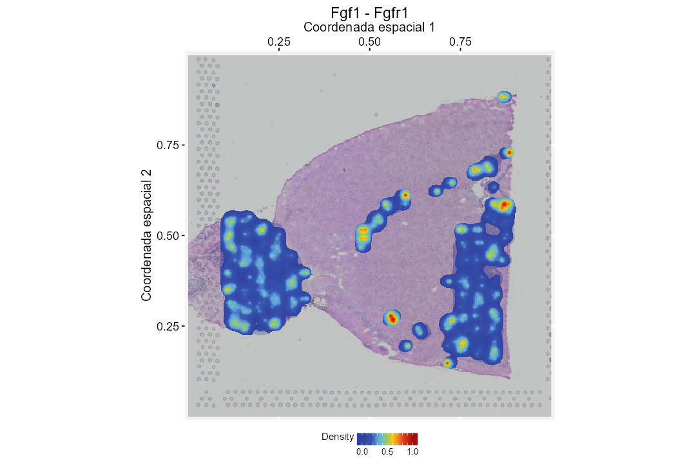{height="78%" fig-align="center"}

## Três receptores de Fgf1

::: {.columns}
::: {.column width="33%"}
{width="100%"}
:::
::: {.column width="33%"}
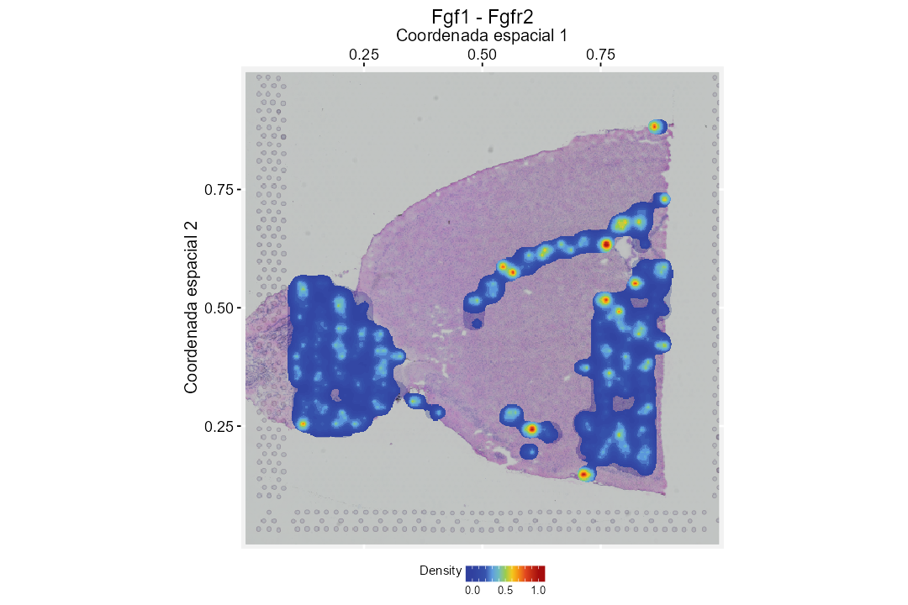{width="100%"}
:::
::: {.column width="33%"}
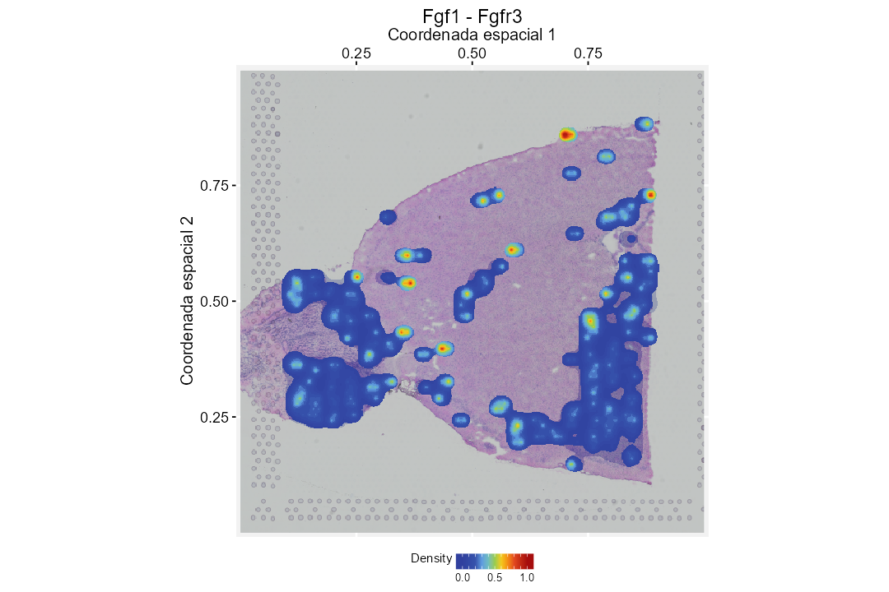{width="100%"}
:::
:::

## Desafio

Repita a análise usando tipos celulares inferidos pelo RCTD em vez dos clusters do Seurat.

```{r}
#| label: cellchat-desafio-demonstracao
#| eval: false

brain_rctd <- readRDS(
  file.path(
    diretorio_resultados,
    "stxbrain_Seurat_com_RCTD.rds"
  )
)

metadados$labels <- brain_rctd$first_type
```

```{r}
#| label: cellchat-liberar-memoria
#| include: false

rm(comunicacoes, top_interacoes)
invisible(gc())
```

# Segmentação celular em Visium HD {background-color="#0B3B49"}

## Alta definição espacial

![Exemplo de estudo com Visium HD em populações imunes de câncer colorretal. Fonte: Oliveira et al. (2025) [@DeOliveira2025VisiumHD].](assets/visiumhd-paper.png){width="77%" fig-align="center"}

## O que esta prática faz

- Usa limites celulares já estimados pelo processamento do Visium HD.
- Não executa um novo algoritmo de segmentação.
- Representa cada célula como centro e como polígono.
- Projeta a expressão de PIGR no espaço contínuo.

## Objeto preparado

```{r}
#| label: segmentacao-carregar
#| cache: false

suppressPackageStartupMessages({
  library("RGraphSpace")
  library("PathwaySpace")
  library("sf")
  library("patchwork")
})

arquivo_visiumhd <- arquivo_obrigatorio(
  diretorio_dados,
  "VisiumHD_GS_Crop.RDS"
)

gs_crop <- readRDS(arquivo_visiumhd)

stopifnot(inherits(gs_crop, "GraphSpace"))

data.frame(
  componente = c("células", "genes"),
  valor = c(nrow(gs_crop@nodes), ncol(gs_crop@fdata))
) |>
  knitr::kable(row.names = FALSE)
```

## Geometrias celulares

```{r}
#| label: segmentacao-geometrias
#| cache: false

geometrias_celulares <- gs_crop@nodes$cellseg

tipos_geometria <- as.data.frame(
  table(sf::st_geometry_type(geometrias_celulares)),
  stringsAsFactors = FALSE
)

names(tipos_geometria) <- c("geometria", "celulas")

knitr::kable(
  tipos_geometria,
  row.names = FALSE
)
```

O objeto contém 539 células, com geometrias POLYGON e MULTIPOLYGON alinhadas aos nós do GraphSpace.

## Células individuais

```{r}
#| label: segmentacao-celulas-individuais
#| cache: false
#| fig-show: hold
#| out-width: "30%"
#| fig-width: 4
#| fig-height: 4

plot(geometrias_celulares[1], main = "Celula 1")
plot(geometrias_celulares[2], main = "Celula 2")
plot(geometrias_celulares[3], main = "Celula 3")
```

## Primeiras vinte geometrias

```{r}
#| label: segmentacao-combinar
#| cache: false
#| fig-width: 6
#| fig-height: 5.5
#| out-width: "62%"

plot(
  sf::st_combine(geometrias_celulares[1:20]),
  main = "Contornos preservados"
)
```

## Limites sobre a imagem do tecido

```{r}
#| label: segmentacao-limites
#| cache: false
#| fig-width: 7.5
#| fig-height: 5.6
#| out-width: "76%"

p_limites <- ggplot(gs_crop) +
  annotation_gspace_image(gs_crop, opacity = 1) +
  geom_sf(
    aes(geometry = cellseg),
    fill = NA,
    linewidth = 0.35,
    colour = "cyan"
  ) +
  geom_nodespace(
    colour = "black",
    size = 0.25,
    pch = 19
  ) +
  theme_gspace_coords(
    theme = "th3",
    is_norm = TRUE,
    xlab = "Coordenada do tecido 1",
    ylab = "Coordenada do tecido 2"
  )

p_limites
```

## Células como vértices

```{r}
#| label: segmentacao-vertices
#| cache: false
#| fig-width: 7
#| fig-height: 5.4
#| out-width: "74%"

cpal_segmentacao <- hcl.colors(
  100,
  palette = "Geyser",
  rev = FALSE
)

intervalo_pigr <- range(
  log2(gs_crop@fdata[, "PIGR"] + 1),
  na.rm = TRUE
)

p_vertices <- ggplot(gs_crop) +
  annotation_gspace_image(gs_crop, opacity = 1) +
  geom_nodespace(
    aes(colour = log2(PIGR + 1)),
    size = 1.5,
    pch = 19
  ) +
  scale_colour_continuous(
    palette = cpal_segmentacao,
    limits = intervalo_pigr
  ) +
  theme_gspace_coords(
    theme = "th3",
    is_norm = TRUE,
    xlab = "Coordenada do tecido 1",
    ylab = "Coordenada do tecido 2"
  )

p_vertices
```

## Células como polígonos

```{r}
#| label: segmentacao-poligonos
#| cache: false
#| fig-width: 7
#| fig-height: 5.4
#| out-width: "74%"

p_poligonos <- ggplot(gs_crop) +
  annotation_gspace_image(gs_crop, opacity = 1) +
  geom_sf(
    aes(
      geometry = cellseg,
      fill = log2(PIGR + 1)
    ),
    linewidth = 0.15
  ) +
  scale_fill_continuous(
    palette = cpal_segmentacao,
    limits = intervalo_pigr
  ) +
  geom_nodespace(
    colour = "black",
    size = 0.2,
    pch = 19
  ) +
  theme_gspace_coords(
    theme = "th3",
    is_norm = TRUE,
    xlab = "Coordenada do tecido 1",
    ylab = "Coordenada do tecido 2"
  )

p_poligonos
```

## Centros e limites celulares

```{r}
#| label: segmentacao-comparacao
#| cache: false
#| fig-width: 12
#| fig-height: 5.5
#| out-width: "100%"

p_vertices + p_poligonos +
  patchwork::plot_annotation(
    title = "Expressao de PIGR no Visium HD"
  )
```

## Construir o PathwaySpace

```{r}
#| label: segmentacao-pathwayspace
#| cache: false

pspace_visiumhd <- buildPathwaySpace(
  gs_crop,
  nrc = 700
)

vizinhos_visiumhd <- getNearestNode(pspace_visiumhd)
pdist_visiumhd <- mean(vizinhos_visiumhd$dist)

pspace_visiumhd <- silhouetteMapping(
  pspace_visiumhd,
  fill.cavity = FALSE,
  baseline = 0.03,
  pdist = max(vizinhos_visiumhd$dist)
)

pdist_visiumhd
```

## Silhueta de projeção

```{r}
#| label: segmentacao-silhueta
#| cache: false
#| fig-width: 7.4
#| fig-height: 5.4
#| out-width: "75%"

ggplot(pspace_visiumhd) +
  annotation_gspace_image(pspace_visiumhd) +
  annotation_pspace_signal(
    pspace_visiumhd,
    si.alpha = 0.5
  ) +
  theme_gspace_coords(
    theme = "th3",
    is_norm = TRUE,
    xlab = "Coordenada do tecido 1",
    ylab = "Coordenada do tecido 2"
  )
```

## Projetar PIGR

```{r}
#| label: segmentacao-projecao
#| cache: false

activeFeature(pspace_visiumhd) <- "PIGR"

pspace_visiumhd <- circularProjection(
  pspace_visiumhd,
  k = gs_vcount(pspace_visiumhd),
  decay.fun = weibullDecay(
    decay = 0.5,
    pdist = pdist_visiumhd
  )
)
```

## Polígono e sinal contínuo

```{r}
#| label: segmentacao-painel-final
#| cache: false
#| fig-width: 12
#| fig-height: 5.5
#| out-width: "100%"

p_projecao <- ggplot(pspace_visiumhd) +
  annotation_gspace_image(pspace_visiumhd) +
  annotation_pspace_signal(
    pspace_visiumhd,
    si.alpha = 0.4,
    title = "PIGR"
  ) +
  theme_gspace_coords(
    theme = "th3",
    is_norm = TRUE,
    xlab = "Coordenada do tecido 1",
    ylab = "Coordenada do tecido 2"
  )

p_poligonos + p_projecao +
  patchwork::plot_annotation(
    title = "RGraphSpace e PathwaySpace"
  )
```

## Leitura da comparação

- Os vértices resumem a posição de cada célula.
- Os polígonos preservam forma e área.
- A projeção contínua mostra como o sinal se distribui entre os centros.
- O GraphSpace mantém expressão, posição e geometria alinhadas [@RGraphSpace2026].

```{r}
#| label: segmentacao-liberar-memoria
#| include: false
#| cache: false

rm(
  gs_crop,
  geometrias_celulares,
  p_limites,
  p_vertices,
  p_poligonos,
  pspace_visiumhd,
  p_projecao
)
invisible(gc())
```

# Referências e análises downstream {background-color="#0B3B49"}

## Anotação de tipos celulares

| Método | Pergunta central | Referência |
|---|---|---|
| RCTD | quais tipos compõem cada spot? | @Cable2022RCTD |
| cell2location | qual abundância espacial de tipos finos? | @Kleshchevnikov2022Cell2location |

Os dois métodos dependem de uma referência anotada e de compatibilidade entre a referência e o tecido.

## Genes espacialmente variáveis

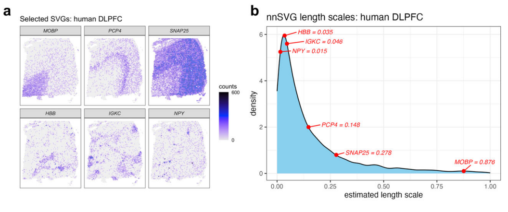{width="88%" fig-align="center"}

- SpatialDE modela padrões espaciais com processos gaussianos [@Svensson2018SpatialDE].
- nnSVG usa aproximações por vizinhos para ganhar escala [@Weber2023NnSVG].
- SPARK-X testa padrões espaciais sem um modelo paramétrico rígido [@Zhu2021SPARKX].

## Microambientes teciduais

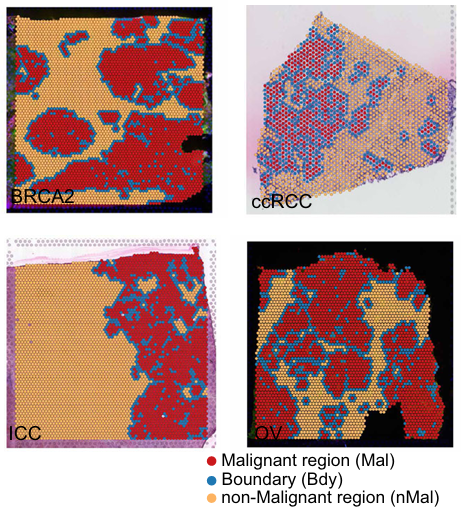{height="72%" fig-align="center"}

NCEM modela comunicação em grafos celulares [@Fischer2023NCEM]. Cottrazm reconstrói o microambiente tumoral ao longo do eixo maligno, borda e não maligno [@Xun2023TumorMicroenvironment].

## Ecossistemas integrados

**Squidpy**

- grafos espaciais, estatísticas de vizinhança e imagens;
- integração com o ecossistema Scanpy [@Palla2022Squidpy].

**Giotto**

- visualização, domínios, vizinhanças e comunicação;
- fluxo integrado para dados espaciais [@Dries2021Giotto].

## Alinhamento e reconstrução 3D

::: {.columns}
::: {.column width="76%"}
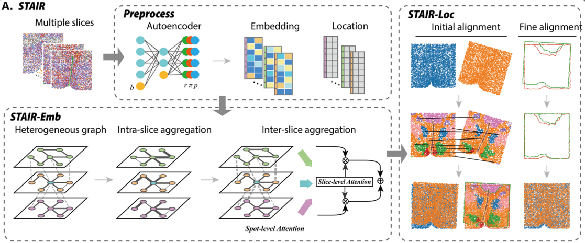{width="100%"}
:::
::: {.column width="24%"}
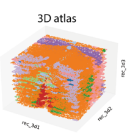{width="100%"}
:::
:::

STAIR combina alinhamento espacial e integração entre fatias [@Yu2025STAIR].

## Do 3D ao 4D

::: {.columns}
::: {.column width="55%"}
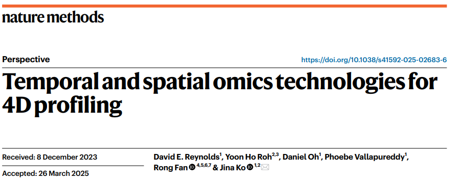{width="100%"}
:::
::: {.column width="45%"}
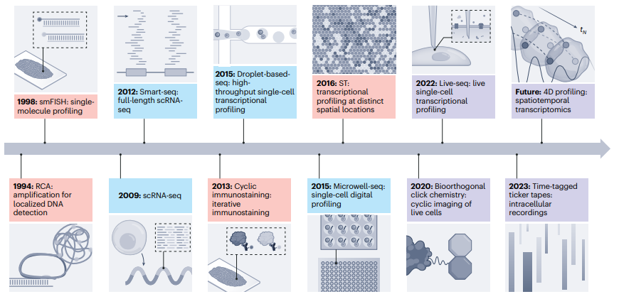{width="100%"}
:::
:::

O 4D incorpora dinâmica temporal à reconstrução espacial [@Reynolds2025FourD].

## Comparar plataformas antes do experimento

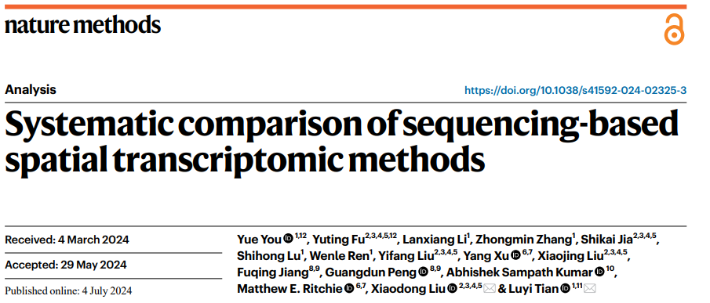{width="78%" fig-align="center"}

A escolha depende de resolução, área, sensibilidade, compatibilidade com histologia e custo [@You2024SpatialMethods].

## Guia prático de decisão

| Pergunta | Unidade de análise | Famílias de métodos |
|---|---|---|
| composição celular | spot ou célula | RCTD, cell2location |
| padrão espacial de genes | gene e coordenadas | SpatialDE, nnSVG, SPARK-X |
| nichos e microambientes | grafo espacial | NCEM, Cottrazm |
| ecossistema completo | objeto multimodal | Squidpy, Giotto |
| reconstrução entre cortes | fatia e volume | STAIR |
| dinâmica espaço-temporal | tecido ao longo do tempo | perfilamento 4D |

## Fronteiras da área

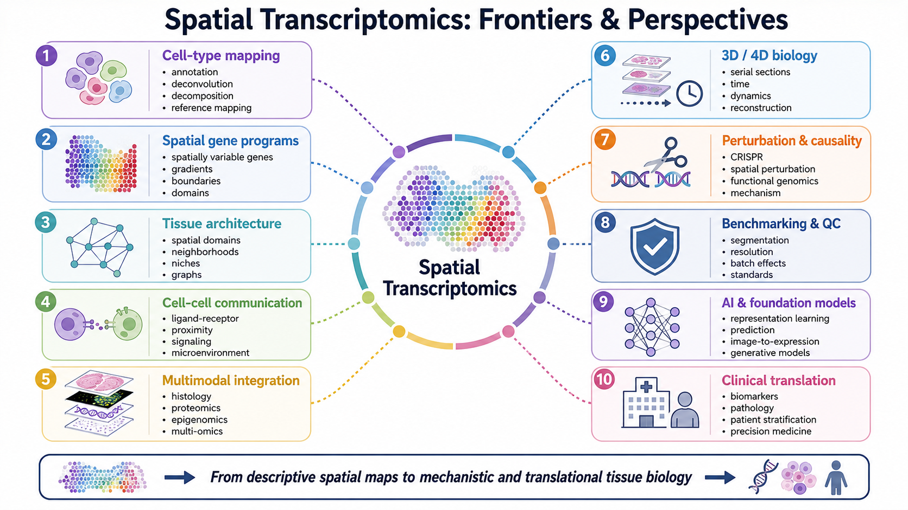{width="94%" fig-align="center"}

## Leituras recomendadas

Material complementar do curso:

[flaviogckessler.github.io/Curso_ST/apresentacoes/LEITURA_RECOMENDADA.html](https://flaviogckessler.github.io/Curso_ST/apresentacoes/LEITURA_RECOMENDADA.html)

Priorize a leitura da documentação do método, do artigo original e de benchmarks independentes.

## Referências citadas {#refs .scrollable}

## Atividade final

Escolha um dos três resultados produzidos na aula:

- tipos celulares do RCTD;
- comunicação ligante-receptor;
- expressão celular segmentada no Visium HD.

Formule uma hipótese biológica e indique qual validação visual ou estatística seria necessária.

## Créditos

SysbioLab, Laboratório de Bioinformática e Biologia de Sistemas, UFPR

- Prof. Dr. Mauro Antônio Alves Castro
- Jean S. S. Resende
- Jonathan André Back
- Lana Bazan Peters Querne
- Flávio Gabriel Carazza-Kessler

[github.com/sysbiolab](https://github.com/sysbiolab)  
[bioinfo.ufpr.br](https://bioinfo.ufpr.br)

## Obrigado

Dúvidas?
